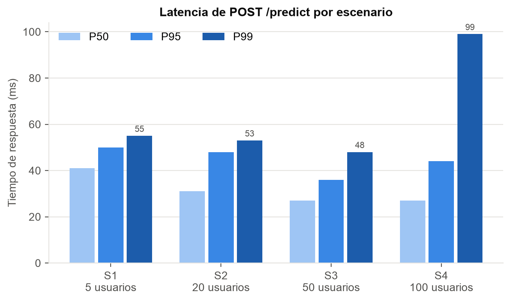
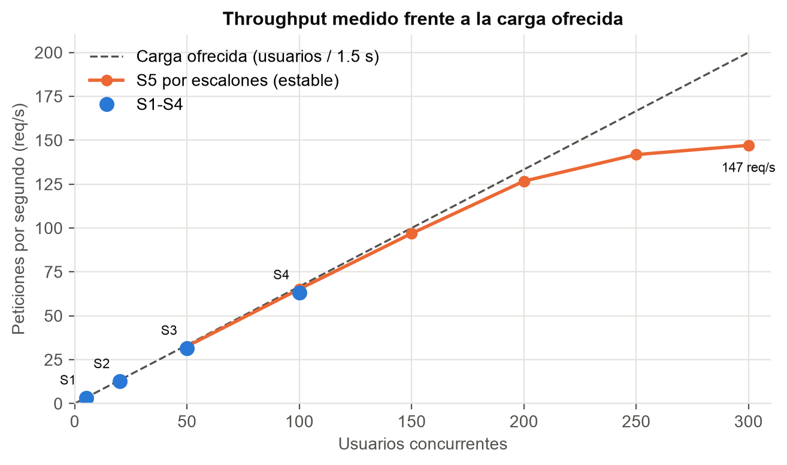
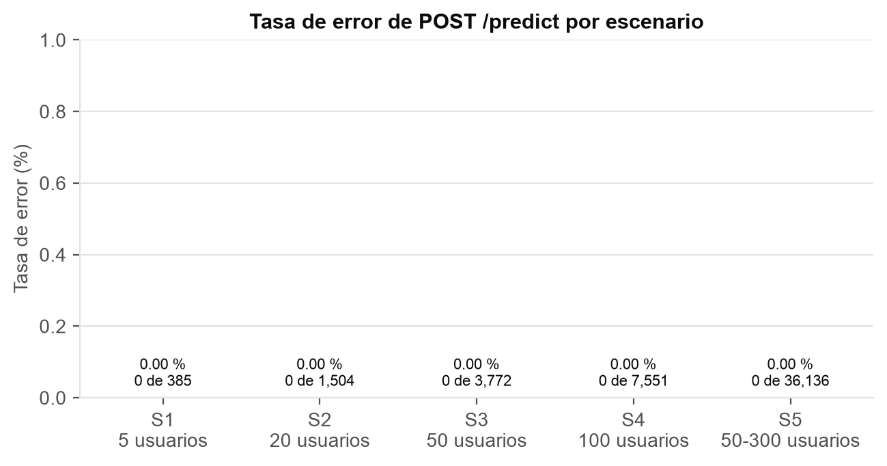
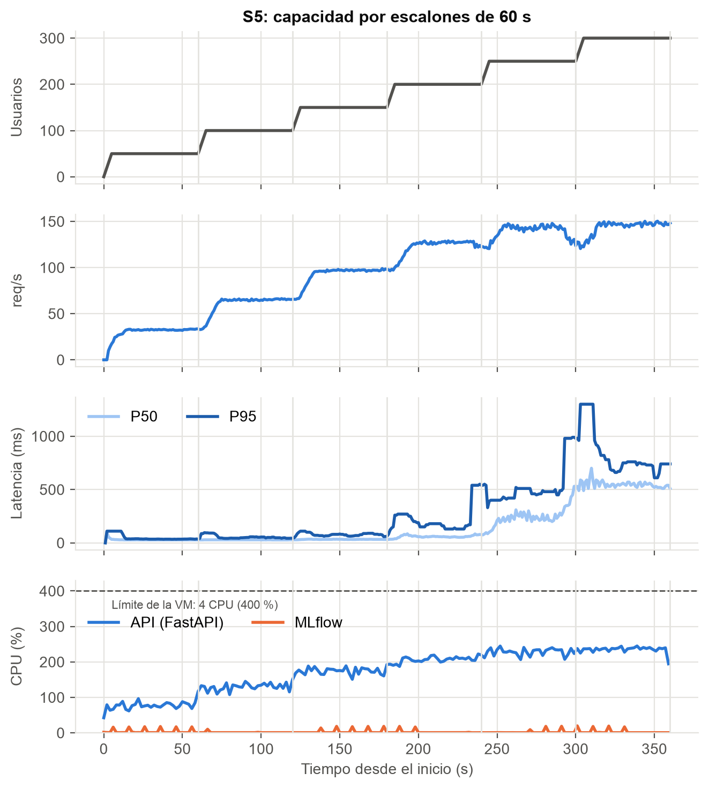
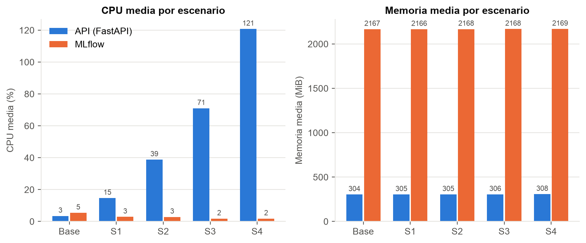

# Semana 10 - Pruebas de carga y monitoreo de recursos

Responsable: Oscar Gutiérrez (A00832992)

## 1. Objetivo y entorno

Medir cómo responde `POST /predict` del Champion P1 (`mibici-equipo15-p1-demanda`, alias `champion`) cuando varios usuarios solicitan predicciones al mismo tiempo, encontrar el límite del servicio y registrar el CPU y la memoria de los contenedores como insumo para el análisis FinOps.

El sistema es el de `docker-compose.yml` ([`compose.md`](compose.md)): la API con FastAPI y un solo proceso de Uvicorn, y MLflow como Tracking Server y Model Registry. La API carga el modelo una vez al arrancar y responde cada predicción con el modelo en memoria, sin consultar a MLflow. Locust corre en la Mac, fuera de la máquina virtual de Docker.

| Componente | Versión o configuración |
|---|---|
| Equipo | Apple M2 Pro, 16 GB, macOS 26.6.2 |
| Contenedores | Docker Engine 28.4.0, Docker Compose 2.39.4 |
| Máquina virtual | 4 CPU y 3.8 GiB utilizables (los mismos 4 CPU y 4 GiB de la validación de `compose.md`) |
| API | FastAPI 0.162.0, Uvicorn 0.54.0, MLflow 3.16.1, scikit-learn 1.9.1, `HistGradientBoostingRegressor` |
| Carga y monitoreo | Locust 2.47.0 (Python 3.12.10), `docker stats` cada ~2 s |

## 2. Escenarios

| Escenario | Usuarios | Incorporación | Duración |
|---|---:|---:|---|
| Línea base | 0 | - | 30 s |
| S1 | 5 | 1/s | 2 min |
| S2 | 20 | 2/s | 2 min |
| S3 | 50 | 5/s | 2 min |
| S4 | 100 | 10/s | 2 min |
| S5 | 50 a 300 | 10/s | 6 min, escalones de 50 usuarios cada 60 s |

Cada usuario espera entre 1 y 2 segundos y envía una de 1,000 filas reales de marzo de 2025 (`load_tests/payloads_p1.json`, tomadas de `evaluation.parquet` de la semana 9 con semilla 42). Una solicitud cuenta como exitosa solo si responde HTTP 200, con el modelo correcto y una predicción finita y no negativa. Con una espera media de 1.5 s, N usuarios ofrecen unas N / 1.5 req/s.

S1 a S4 quedaron por debajo del límite del servicio, por eso se agregó S5 para encontrarlo. Los escenarios corren uno a la vez con 30 s de pausa, y `collect_container_stats.py` registra CPU y memoria mientras corre Locust. En S5 cada escalón se resume sin sus primeros 15 s.

## 3. Resultados

### 3.1 Locust

| Escenario | Solicitudes | Error (%) | P50 (ms) | P95 (ms) | P99 (ms) | req/s | Ofrecido (req/s) |
|---|---:|---:|---:|---:|---:|---:|---:|
| S1 (5 usuarios) | 385 | 0 | 41 | 50 | 55 | 3.2 | 3.3 |
| S2 (20 usuarios) | 1,504 | 0 | 31 | 48 | 53 | 12.6 | 13.3 |
| S3 (50 usuarios) | 3,772 | 0 | 27 | 36 | 48 | 31.5 | 33.3 |
| S4 (100 usuarios) | 7,551 | 0 | 27 | 44 | 99 | 63.2 | 66.7 |
| S5, 150 usuarios | - | 0 | 33 | 76 | 97 | 96.9 | 100.0 |
| S5, 200 usuarios | - | 0 | 59 | 170 | 220 | 126.7 | 133.3 |
| S5, 250 usuarios | - | 0 | 250 | 485 | 540 | 141.8 | 166.7 |
| S5, 300 usuarios | - | 0 | 540 | 740 | 780 | 147.1 | 200.0 |

S5 procesó 36,136 solicitudes en total y sus escalones de 50 y 100 usuarios coinciden con S3 y S4. Fuentes: `load_summary.csv` y `load_capacity_steps.csv` en `reports/week10/metrics/`.









Hasta 150 usuarios el throughput siguió la carga ofrecida y la mediana quedó cerca de 30 ms. Con 200 usuarios el throughput todavía creció, pero la mediana se duplicó. Desde 250 usuarios el throughput se quedó en alrededor de 145 req/s y la mediana subió hasta 540 ms. No hubo errores en ninguna de las 49,348 solicitudes ni reinicios de contenedores.

### 3.2 Recursos

| Escenario | API CPU media / máx. (%) | API memoria (MiB) | MLflow CPU media (%) | MLflow memoria (MiB) |
|---|---:|---:|---:|---:|
| Línea base | 3.5 / 17.6 | 304 | 5.4 | 2,167 |
| S1 | 14.7 / 48.8 | 305 | 2.9 | 2,166 |
| S2 | 38.8 / 56.6 | 305 | 2.9 | 2,168 |
| S3 | 71.0 / 89.0 | 306 | 1.8 | 2,168 |
| S4 | 120.8 / 145.1 | 308 | 1.8 | 2,169 |
| S5, 300 usuarios | 235.5 / 244.9 | 317 | 2.2 | 2,177 |

100 % equivale a un núcleo y el máximo de la máquina virtual es 400 %. Fuentes: `resource_summary.csv` y `resource_capacity_steps.csv`.



La CPU de la API creció con la carga y se detuvo en cerca de 2.4 núcleos en S5. Dividida entre el throughput, equivale a unos 16 ms de CPU por solicitud desde 200 usuarios, y a 24 ms con 50 usuarios porque el consumo en reposo se reparte entre menos solicitudes. La memoria de la API apenas cambió. MLflow mantuvo 2.17 GiB y menos de 6 % de CPU en todos los escenarios.

## 4. Análisis y mejoras

El servicio atiende hasta unas 100 req/s (150 usuarios) con P95 por debajo de 80 ms, y su máximo es de alrededor de 145 req/s. Por encima de ese punto las solicitudes esperan en cola. La saturación se ve en la latencia y no en errores, así que P95 la detecta mejor que la tasa de error.

El límite está en el proceso de la API. Cuando el throughput se detuvo, la API usaba 2.4 de 4 núcleos y los contenedores 2.4 de 3.8 GiB, así que la máquina virtual todavía tenía recursos. `POST /predict` es síncrona y corre en el pool de hilos de un solo proceso. Una explicación posible, que estas pruebas no comprobaron, es que la parte en Python de cada solicitud (Pydantic, DataFrame, respuesta) queda limitada por el GIL, mientras que la predicción de `HistGradientBoostingRegressor` usa hilos de OpenMP que agregan CPU sin aumentar el throughput. Eso sería consistente con 16 ms de CPU para predecir una sola fila.

MLflow es un costo fijo: ocupa cerca del 87 % de la memoria de los dos contenedores y no cambia con la carga, porque solo se usa al arrancar la API.

Mejoras propuestas, ninguna probada todavía. Cada una debe medirse repitiendo S5:

1. Fijar `OMP_NUM_THREADS=1` en el servicio `api` y comparar la CPU por solicitud y el throughput máximo.
2. Ejecutar Uvicorn con `--workers 2` para usar los núcleos libres. Cada proceso carga su propia copia del modelo, unos 300 MiB más, y hay 1.4 GiB libres. Conviene probarlo por separado de la mejora 1.
3. Separar MLflow del servicio de inferencia, cargando el modelo al construir la imagen o al iniciar sin un servidor MLflow en la misma máquina. La memoria por instancia de inferencia bajaría de unos 2.4 GiB a unos 0.3 GiB. Cambia la arquitectura de Compose y debe acordarse con el equipo.
4. Basar alertas o escalamiento en P95, que en estas pruebas se mantuvo por debajo de 80 ms en operación normal y llegó a 170 ms al empezar la degradación.
5. Hacer una prueba de una hora o más cerca de 100 req/s para descartar fugas de memoria.

## 5. Limitaciones y reproducción

- Las pruebas corrieron en una máquina virtual local sobre macOS. Los valores absolutos no equivalen a una instancia en la nube, aunque el patrón de saturación sí sirve de referencia.
- Locust comparte el procesador físico con la máquina virtual. No emitió advertencias de CPU, pero no se midió su consumo.
- Cada escenario corrió una vez y por pocos minutos, sin intervalos de variación ni prueba de estabilidad prolongada.
- `docker stats --no-stream` da instantáneas aproximadas de CPU, no el tiempo total consumido.
- La causa del límite de la API es una hipótesis.

Desde la raíz del repositorio, con `runtime/mlflow/` preparado como indica [`compose.md`](compose.md#datos-de-mlflow):

```bash
python3.12 -m venv .venv-locust
.venv-locust/bin/python -m pip install -r requirements-loadtest.txt
docker compose -f docker-compose.yml up -d --build
bash scripts/week10/run_load_tests.sh docker
bash scripts/week10/run_capacity_test.sh docker
.venv-locust/bin/python scripts/week10/summarize_resources.py
.venv-locust/bin/python scripts/week10/plot_load_results.py
```

Los scripts aceptan `podman` en lugar de `docker`. Los resultados quedan en `reports/week10/locust/`, `reports/week10/metrics/` y `reports/week10/figures/`, y `run_log.txt` registra horas, commit y reinicios de cada ejecución.
