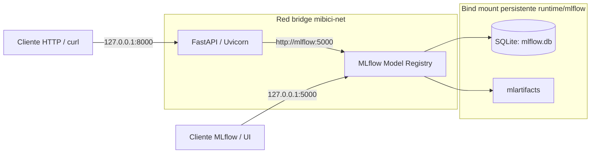

# Integración y despliegue del servicio de inferencia MiBici

**TC5061 — Operaciones de aprendizaje automático | Equipo 15 | Semana 11**  
**Fecha de validación local:** 25 de noviembre de 2026 (Ciudad de México).  
**Rama:** `feature/week11-deployment-integration-A01797899`  
**Repositorio:** [TC5061-Proyecto-Equipo15](https://github.com/A01797899/TC5061-Proyecto-Equipo15)

## 1. Objetivo y alcance

Demostrar la operación de extremo a extremo del modelo P1 de demanda de MiBici, desde su registro en MLflow hasta la respuesta HTTP de FastAPI contenerizada. Validamos el contrato de entrada, la construcción de imágenes, la comunicación entre servicios, la disponibilidad, la inferencia reproducible, el manejo de errores, las pruebas de regresión, la persistencia de los artefactos y la integración continua.

Reutilizamos el trabajo de las semanas anteriores: el Champion histórico P1, los Containerfiles, Docker Compose y el workflow de la semana 10. El único cambio de configuración publicado para estas validaciones fue la exclusión de entornos virtuales locales de los contextos de construcción. No se incorporaron Redis ni RQ, no se modificó el pipeline y no se promovió el Challenger. Las pruebas de carga y el análisis FinOps integral se documentan por separado; aquí se presentan únicamente los resultados de optimización relacionados con la construcción de imágenes.

## 2. Arquitectura



FastAPI consulta el alias `champion`, resuelve la versión registrada y carga el modelo mediante `mlflow.pyfunc.load_model`. MLflow conserva metadatos en SQLite y sirve los artefactos desde el directorio persistente. La carga se realiza durante el arranque de la API, no mediante una consulta al Registry por cada predicción. Los puertos publicados están restringidos a loopback; esta validación corresponde a un despliegue local, no a una exposición pública de producción.

## 3. Ambiente y preparación

| Componente | Ambiente local validado |
|---|---|
| Sistema anfitrión | macOS |
| Python | 3.12.15 (entorno virtual); 3.12.16 (imagen API) |
| Podman | 5.8.9 |
| podman-compose | 1.6.0 |
| GitHub CLI | 2.97.0 |
| MLflow | 3.16.1 |
| FastAPI | 0.162.0 |
| Uvicorn | 0.54.0 |
| Pydantic | 2.14.4 |
| scikit-learn | 1.9.1 |
| skops | 0.16.0 |
| Pytest | 9.1.1 |
| VM Podman | 4 CPU, 8192 MiB RAM, 27 GiB de disco |

La rama de trabajo se creó desde `f5d230e875c0e1de63823e8828a5ccd039923fa3`. Se verificó la autenticación de GitHub CLI y la disponibilidad del workflow. Se creó un entorno virtual Python 3.12 para evitar utilizar el alias local de Python 3.13; se instalaron las dependencias API y de desarrollo y se ejecutó `pip check` sin conflictos.

Preparación reproducible desde una copia del repositorio en la rama de trabajo:

```bash
python3.12 -m venv .venv
source .venv/bin/activate
python -m pip install -r requirements-api.txt -r requirements-dev.txt
python -m pip install podman-compose==1.6.0
python -m pip check
podman machine list
podman info
export PROJECT_ROOT="$PWD"
export COMPOSE_PROJECT_NAME=mibici-week11
export COMPOSE_BASE_FILE="$PROJECT_ROOT/docker-compose.yml"
export API_URL=http://127.0.0.1:8000
export MLFLOW_URL=http://127.0.0.1:5000
```

En macOS se requiere una máquina Podman operativa; si ya existe pero está detenida, iniciar con `podman machine start`. Los puertos 5000 y 8000 deben estar libres. No es necesario eliminar contenedores históricos. Se utiliza explícitamente `podman-compose` para evitar seleccionar otro proveedor Compose instalado en el anfitrión.

Evidencias: [rama](../../reports/week11/evidence/deployment/00_rama_trabajo.png), [Python](../../reports/week11/evidence/deployment/00a_python_environment.png), [Podman](../../reports/week11/evidence/deployment/00c_podman_environment.png), [dependencias](../../reports/week11/evidence/deployment/00_environment_packages.txt), [Git](../../reports/week11/evidence/deployment/00_git_environment.txt).

## 4. Validación de FastAPI y MLflow

Se revisaron `mibici/api/main.py`, `schemas.py`, `model_service.py` y `config.py`, así como los módulos de pruebas y los scripts de integración de la semana 10. La aplicación `MiBici Equipo 15 - Prediction API`, versión 1.0.0, expone:

| Endpoint | Función | Respuestas verificadas |
|---|---|---|
| `GET /health` | Disponibilidad del proceso | 200 |
| `GET /ready` | Modelo disponible para inferencia | 200; 503 en prueba simulada |
| `POST /predict` | Inferencia del modelo P1 | 200, 422, 503 y 500 (estos dos últimos en pruebas simuladas) |

El contrato exige ocho características: `hour_of_day`, `weekday`, `fin_semana`, `salidas_lag_1h`, `salidas_lag_24h`, `salidas_lag_168h`, `media_estacion`, `media_estacion_dia_hora`. Se validan el conjunto de campos, rangos, consistencia del calendario y valores numéricos. El servicio ordena las características según la firma, utiliza valores float64, valida la salida y limita las predicciones negativas a cero. La resolución del alias y la carga del modelo ocurren durante el ciclo de vida de la aplicación. Si el modelo no está listo, el endpoint de disponibilidad del proceso puede continuar respondiendo, mientras readiness indica indisponibilidad.

Se verificaron OpenAPI, compilación de código y 11 comprobaciones complementarias de Pydantic. Se observó que algunos valores fraccionarios en hora y día de semana (8.5 y 2.5) eran aceptados; se conserva el contrato existente y se registra como mejora potencial, sin afirmar que todos los campos discretos rechazan fracciones.

Evidencia: [validación Pydantic](../../reports/week11/evidence/deployment/00d_pydantic_validation.png).

## 5. Preparación del Registry histórico

Se seleccionó el respaldo de la semana 10 `mlflow-runtime-week10.tar.gz`, conservado fuera del repositorio, después de comparar las fuentes históricas disponibles. Se verificó el archivo comprimido y se extrajo a un directorio temporal. La base se copió mediante la API de backup de SQLite y los artefactos mediante copia de directorios al destino `runtime/mlflow/`, sin alterar el respaldo original.

| Indicador | Resultado |
|---|---|
| Integridad SQLite | `ok` |
| Experimentos | 2 |
| Runs | 104 |
| Modelos registrados | 3 |
| Versiones registradas | 4 |
| Alias registrados | 4 |
| Archivos de artefactos comparados | 162/162, SHA-256 idéntico |
| Archivos `MLmodel` de P1 encontrados | 2 |

Modelo P1: `mibici-equipo15-p1-demanda`.

| Alias | Versión | Run ID | Logged model ID | Estado |
|---|---:|---|---|---|
| champion | 1 | `6e3429f222a0407aa159dd9f46699365` | `m-04774b8f25ff468b933a18756c24b068` | READY |
| challenger | 2 | `7074129578d045418cbed0691330d1a7` | `m-ea1a3789403948d08f509f0a562419e5` | READY |

El Champion real utiliza `HistGradientBoostingRegressor`, serializado mediante skops; su firma tiene ocho entradas double y salida float64. Se comprobó la presencia de artefactos de ambas versiones P1. El Registry también contiene metadatos de P2 y P3, pero no se comprobó la disponibilidad de sus respectivos artefactos ni su inferencia. No se cambió ningún alias.

Para reproducir el despliegue real se necesita una copia autorizada del respaldo histórico: el repositorio y el pipeline por sí solos no contienen ese modelo. La estructura esperada es `runtime/mlflow/mlflow.db` y `runtime/mlflow/mlartifacts/`. Antes de copiar, verificar que el destino no contenga un Registry que deba preservarse. No sobrescribir una base activa. Validar la integridad de SQLite y comparar los hashes de los artefactos con la fuente. Los datos de ejecución y los respaldos se mantienen fuera de Git.

Evidencia: [Registry histórico](../../reports/week11/evidence/deployment/00b_real_registry_backup.png).

## 6. Docker Compose y Containerfiles

Se conservaron los archivos `docker-compose.yml`, `Containerfile` y `Containerfile.mlflow` existentes. El Containerfile de FastAPI usa Python 3.12 slim, instala `requirements-api.txt`, ejecuta como usuario no privilegiado y expone el puerto 8000. MLflow usa Python 3.12 slim e instala MLflow 3.16.1.

| Propiedad | FastAPI | MLflow |
|---|---|---|
| Servicio | api | mlflow |
| Imagen | mibici-api:week10 | mibici-mlflow:week10 |
| Puerto anfitrión | 127.0.0.1:8000 | 127.0.0.1:5000 |
| Healthcheck | `/ready` | `/health` |
| Intervalo / timeout | 10 s / 5 s | 10 s / 5 s |
| Reintentos / start period | 12 / 60 s | 12 / 30 s |
| Persistencia | No requerida para la API | `./runtime/mlflow:/mlflow` |
| Reinicio | unless-stopped | unless-stopped |

La API depende del estado saludable de MLflow y utiliza `MLFLOW_TRACKING_URI=http://mlflow:5000`. Los servicios comparten una red bridge. MLflow usa `sqlite:////mlflow/mlflow.db`, sirve artefactos desde `/mlflow/mlartifacts` y permite los hosts configurados para el acceso local e interno. La configuración fue validada con:

```bash
podman-compose -p "$COMPOSE_PROJECT_NAME" -f "$COMPOSE_BASE_FILE" config
```

Se conservaron los tags `week10` y se aisló el despliegue mediante el nombre de proyecto `mibici-week11`. Esto crea contenedores y red propios, pero no aísla el almacén global de imágenes ni permite compartir simultáneamente los mismos puertos publicados con otros proyectos.

Evidencia: [configuración Compose](../../reports/week11/evidence/deployment/00f_compose_validation.png).

## 7. Construcción y optimización de imágenes

El análisis de la imagen histórica FastAPI reveló la inclusión de `/app/.venv-repro`, de aproximadamente 854 MB. Las capas de copia y cambio de propietario aumentaban innecesariamente el tamaño. Se añadieron las exclusiones `.venv-locust/` y `.venv-*/` tanto a `.containerignore` como a `.dockerignore`, manteniendo ambos archivos sincronizados. La regla específica de Locust es redundante con el patrón general, pero se conservó explícitamente para facilitar la lectura.

```bash
podman-compose -p "$COMPOSE_PROJECT_NAME" -f "$COMPOSE_BASE_FILE" build
podman images
podman run --rm --network none --entrypoint python mibici-api:week10 --version
podman run --rm --network none --entrypoint python mibici-api:week10 -m pip check
```

| Indicador | Antes (local histórico) | Después (local) | CI |
|---|---:|---:|---:|
| FastAPI | 3.12 GB | 1.46 GB | 1.46 GB |
| MLflow | 922 MB | 922 MB | 929 MB |

Reducción aproximada de FastAPI: `(3.12 - 1.46) / 3.12 × 100 = 53.21 %`, equivalente a 1.66 GB según tamaños redondeados reportados. Las capas COPY y chown pasaron de aproximadamente 835 MB cada una a 1.12 MB y 1.14 MB, respectivamente. Se verificaron siete exclusiones, Python, usuario no privilegiado, dependencias revisadas, OpenAPI y `pip check` dentro de la imagen.

Este resultado constituye una aportación de optimización técnica a FinOps: reduce el tamaño de distribución potencial y evita empaquetar dependencias locales duplicadas. No demuestra por sí mismo un ahorro monetario, una reducción equivalente de almacenamiento físico (las capas pueden compartirse), ni una mejora cuantificada en latencia o tiempo de build. No se ejecutó un prune de imágenes y no se modificaron las dependencias declaradas ni la lógica del servicio. Los tamaños coincidentes entre ambientes no prueban identidad binaria.

Commit publicado: [`c6901c9`](https://github.com/A01797899/TC5061-Proyecto-Equipo15/commit/c6901c906ed6e3db9bdf99ec697fcd8700cdf9b2), `perf(week11): exclude local virtual environments from container builds`.

Evidencias: [exclusiones](../../reports/week11/evidence/deployment/00e_container_exclusions.png), [análisis de tamaño](../../reports/week11/evidence/deployment/00g_image_size_analysis.png), [build](../../reports/week11/evidence/deployment/01_container_build.png), [log](../../reports/week11/evidence/deployment/01_container_build.log).

## 8. Despliegue y conectividad

```bash
podman-compose -p "$COMPOSE_PROJECT_NAME" -f "$COMPOSE_BASE_FILE" up -d --no-build
podman-compose -p "$COMPOSE_PROJECT_NAME" -f "$COMPOSE_BASE_FILE" ps
podman network inspect mibici-week11_mibici-net
curl -fsS "$MLFLOW_URL/health"
curl -fsS "$API_URL/health"
curl -fsS "$API_URL/ready"
```

Se comprobó que los dos servicios quedaron saludables. En el arranque inicial, MLflow obtuvo la IP interna 10.89.2.2 y FastAPI 10.89.2.3, en la subred 10.89.2.0/24. Estas direcciones son observaciones de esa ejecución y no deben configurarse de forma fija. Desde el contenedor API se comprobaron URI, DNS, conexión TCP, respuesta HTTP y consulta del Registry (6/6 comprobaciones). Los logs mostraron la resolución del alias Champion a la versión 1 y la descarga de los artefactos requeridos, con respuesta HTTP 200.

| Endpoint | HTTP | Respuesta |
|---|---:|---|
| MLflow `/health` | 200 | Servicio disponible |
| API `/health` | 200 | `{"status":"ok"}` |
| API `/ready` | 200 | `{"ready":true}` |

Readiness no expone la identidad del modelo; esta se corroboró mediante el Registry y los logs de arranque.

Evidencias: [servicios](../../reports/week11/evidence/deployment/02_compose_services.png), [conectividad](../../reports/week11/evidence/deployment/03_container_connectivity.png), [health/readiness](../../reports/week11/evidence/deployment/04_health_ready.png), [contenedores](../../reports/week11/evidence/deployment/04a_containers_healthy.png).

## 9. Inferencia con el Champion real

Se utilizó el cliente HTTP curl y el payload existente `postman/examples/p1-valid.json`. Esta decisión permite ejecutar pruebas desde terminal; no constituye evidencia de una ejecución con Postman o Swagger UI.

```bash
curl -i -sS -X POST "$API_URL/predict" \
  -H 'Content-Type: application/json' \
  --data-binary @postman/examples/p1-valid.json
```

```json
{"features":{"hour_of_day":8,"weekday":2,"fin_semana":0,"salidas_lag_1h":3,"salidas_lag_24h":4,"salidas_lag_168h":5,"media_estacion":2.1,"media_estacion_dia_hora":3.4}}
```

Respuesta observada HTTP 200:

```json
{"prediction":3.694163560787005,"model":"mibici-equipo15-p1-demanda"}
```

Cuatro peticiones devolvieron el mismo valor; las comprobaciones de HTTP, nombre del modelo, valor finito no negativo y coincidencia numérica dentro de tolerancia fueron satisfactorias (4/4). Esta prueba valida el funcionamiento y la reproducibilidad del servicio para el caso de referencia, no la precisión general del modelo.

Evidencias: [predicción](../../reports/week11/evidence/deployment/06_curl_predict.png), [validaciones curl](../../reports/week11/evidence/deployment/06a_curl_tests.png), [respuesta](../../reports/week11/evidence/deployment/06_champion_prediction.txt).

## 10. Solicitudes inválidas y manejo de errores

| Caso | Resultado | Evidencia |
|---|---|---|
| TC05: JSON vacío | 422 | [07a](../../reports/week11/evidence/deployment/07a_empty_json.png) |
| TC06: hora 30 | 422 | [07](../../reports/week11/evidence/deployment/07_curl_invalid_request.png) |
| TC07: característica faltante | 422 | [07b](../../reports/week11/evidence/deployment/07b_missing_feature.png) |
| TC08: demanda negativa | 422 | [07c](../../reports/week11/evidence/deployment/07c_negative_demand.png) |
| TC09: calendario inconsistente | 422 | [07d](../../reports/week11/evidence/deployment/07d_invalid_calendar.png) |
| TC10: ruta inexistente | 404 | [07e](../../reports/week11/evidence/deployment/07e_endpoint_not_found.png) |
| TC11: campo desconocido en sustitución de uno obligatorio | 422, campo requerido ausente | [07f](../../reports/week11/evidence/deployment/07f_unknown_feature.png) |
| TC12: valor no numérico | 422 | [07g](../../reports/week11/evidence/deployment/07g_invalid_datatype.png) |
| TC13: modelo no disponible (simulado) | 503, tres pruebas Pytest | [07h](../../reports/week11/evidence/deployment/07h_model_not_ready.png) |
| TC14: error de predicción (simulado) | 500, tres pruebas Pytest | [07i](../../reports/week11/evidence/deployment/07i_prediction_error.png) |

Resultado: 10/10 casos y 14/14 comprobaciones (ocho HTTP reales y seis pruebas unitarias/de integración con simulación). No se provocaron fallas reales en el Registry histórico para obtener las respuestas 503 y 500.

## 11. Smoke test y regresión local

Se reutilizó `scripts/week10/smoke_integration.py` sin modificaciones:

```bash
python scripts/week10/smoke_integration.py \
  --api-url "$API_URL" --mlflow-url "$MLFLOW_URL" \
  --payload postman/examples/p1-valid.json \
  --expected 3.694163560787005 --tolerance 0.000001 --timeout 30
python -m pytest -v --tb=short --durations=10
```

El smoke test verifica health de MLflow, health y readiness de la API, inferencia, valor de referencia, segunda inferencia, reproducibilidad, ruta inexistente y tres solicitudes inválidas. Resultado 11/11, código de salida 0. No consulta directamente los alias; esta comprobación se realizó por separado mediante MLflowClient.

| Indicador Pytest | Local |
|---|---:|
| Pruebas recolectadas | 315 |
| Aprobadas | 314 |
| Omitidas | 1 |
| Fallidas | 0 |
| Advertencias | 24 |
| Duración | 52.96 s |

La prueba `tests/test_week9_data.py::test_datasets_reales_cumplen_el_contrato` se omitió por ausencia de los datasets reales. La inferencia y el estado saludable de los servicios se verificaron nuevamente después de la regresión.

Evidencias: [smoke](../../reports/week11/evidence/deployment/08_smoke_integration.png), [log smoke](../../reports/week11/evidence/deployment/08_smoke_integration.log), [regresión](../../reports/week11/evidence/deployment/09_pytest_regression.png), [log Pytest](../../reports/week11/evidence/deployment/09_pytest_regression.log).

## 12. Persistencia y recuperación

Se verificó el bind mount de lectura/escritura `runtime/mlflow:/mlflow`. Antes de detener los servicios se generó una línea base con conteos, versiones, alias y hashes de 162 artefactos. Se creó un respaldo preventivo mediante backup consistente de SQLite y copia de artefactos, y se verificó su contenido.

Respaldo local: `runtime/backups/mlflow-before-recovery-20261125-224329.tar.gz` (3,854,719 bytes; SHA-256 `c09a9bb4e1da08316f6427593b5742b9493a9a42715f839fd93d3ec787516ac4`). No se incluye en Git.

Procedimiento de recreación controlada, únicamente después de verificar el respaldo y confirmar el proyecto correcto:

```bash
podman-compose -p "$COMPOSE_PROJECT_NAME" -f "$COMPOSE_BASE_FILE" down
# Comprobar que runtime/mlflow conserva la base y los artefactos.
# Comparar conteos, alias, versiones y SHA-256 con la línea base.
podman-compose -p "$COMPOSE_PROJECT_NAME" -f "$COMPOSE_BASE_FILE" up -d --no-build
podman-compose -p "$COMPOSE_PROJECT_NAME" -f "$COMPOSE_BASE_FILE" ps
```

No usar opciones de eliminación de volúmenes ni borrar `runtime/mlflow`. Tras el `down` se comprobó la integridad SQLite en modo de solo lectura y la conservación de todos los archivos. Se recrearon la red y los dos contenedores, con nuevos IDs y las mismas imágenes. Después se verificaron el Registry por HTTP, el bind mount y la inferencia.

| Indicador | Antes | Después |
|---|---:|---:|
| Experimentos | 2 | 2 |
| Runs | 104 | 104 |
| Modelos registrados | 3 | 3 |
| Versiones | 4 | 4 |
| Alias | 4 | 4 |
| Artefactos conservados | 162 | 162 |
| Archivos faltantes/modificados/adicionales | 0 | 0 |
| Integridad SQLite | ok | ok |
| Predicción P1 | 3.694163560787005 | 3.694163560787005 |
| Smoke test | 11/11 | 11/11 |

Se conservaron versiones, estados, identificadores de runs, fuentes y alias. No fue necesario restaurar el respaldo. La prueba demuestra persistencia y recuperación del servicio frente a recreación de contenedores; no demuestra recuperación ante pérdida física del almacenamiento ni disponibilidad multi-nodo.

Evidencias: [línea base](../../reports/week11/evidence/persistence/01_persistence_baseline.png), [JSON de referencia](../../reports/week11/evidence/persistence/01_registry_before.json), [respaldo](../../reports/week11/evidence/persistence/02_preventive_backup.png), [down](../../reports/week11/evidence/persistence/03_compose_down.png), [persistencia offline](../../reports/week11/evidence/persistence/04_offline_persistence.png), [recreación](../../reports/week11/evidence/persistence/05_compose_recovery.png), [Registry recuperado](../../reports/week11/evidence/persistence/06_registry_recovery.png), [smoke posterior](../../reports/week11/evidence/persistence/07_post_recovery_smoke.png).

## 13. Integración continua con GitHub Actions

Se conservó `.github/workflows/MiBici-pipeline.yml` sin cambios. El workflow admite push a `main` y ramas `feature/week10-*`, pull requests hacia `main` y ejecución manual con las opciones `full`, `tests`, `build`, `integration`. Se seleccionó manualmente `full` porque la rama de semana 11 no coincide con el patrón de push de semana 10. Los tres jobs son independientes y pueden ejecutarse en paralelo.

```bash
gh workflow run MiBici-pipeline.yml \
  --ref feature/week11-deployment-integration-A01797899 \
  -f execution_type=full
gh run watch 45759541454 --exit-status
```

El ID mostrado corresponde a la ejecución histórica; para una nueva ejecución debe utilizarse el nuevo ID devuelto por GitHub CLI.

**Ejecución:** [MiBici-pipeline #19, run 45759541454](https://github.com/A01797899/TC5061-Proyecto-Equipo15/actions/runs/45759541454). Commit `c6901c9`; runner Ubuntu 24.04; duración general 3m 08s; 3/3 jobs exitosos.

| Job | ID | Duración | Resultado |
|---|---|---:|---|
| Pruebas y validación | 139706045711 | 1m 49s | Success |
| Construcción de imágenes Podman | 139706045505 | 2m 15s | Success |
| Integración end-to-end con Registry temporal | 139706045827 | 3m 04s | Success |

### 13.1. Pruebas

72/72 pruebas específicas de FastAPI aprobadas en 2.00 s, con una advertencia. La suite completa registró 303 aprobadas, 12 omitidas, cero fallidas y 24 advertencias en 24.81 s. Las 72 pruebas específicas forman parte de la suite completa y no representan casos únicos adicionales. La diferencia de 11 omisiones respecto al entorno local es compatible con la ausencia de Deepchecks en las dependencias de CI, pero no se comprobaron individualmente los motivos de todas las omisiones.

### 13.2. Construcción

Podman 4.9.3 construyó y verificó ambas imágenes: FastAPI 1.46 GB y MLflow 929 MB. Se conservaron los tags `week10`. La construcción en CI confirma la portabilidad del contexto optimizado, no la igualdad de hashes de las imágenes locales y remotas.

### 13.3. Integración end-to-end

El job prepara un Compose temporal con un solo worker de MLflow, inicia el Registry vacío, registra mediante `scripts/week10/bootstrap_ci_registry.py` un Champion determinista y levanta FastAPI. Se verifica la firma y se ejecuta el smoke test con referencia `2.785`. La predicción obtenida fue `2.785000000000001`; la diferencia corresponde a representación de punto flotante dentro de tolerancia. Resultado 11/11. El paso de logs condicionado a falla fue omitido correctamente. Se publicaron logs y estado de contenedores antes de ejecutar la limpieza del entorno efímero. La limpieza de CI no debe ejecutarse contra el Registry histórico local.

| Aspecto | Local | CI |
|---|---|---|
| Modelo | Champion P1 histórico | Champion determinista de prueba |
| Registry | Persistente | Temporal |
| Predicción observada | 3.694163560787005 | 2.785000000000001 |
| Smoke inicial | 11/11 | 11/11 |
| Smoke posterior a recreación | 11/11 | No aplica |
| Regresión | 314 aprobadas, 1 omitida | 303 aprobadas, 12 omitidas |

Las tres ejecuciones del smoke test suman 33 comprobaciones aprobadas (11 casos reutilizados en tres ejecuciones), no 33 casos distintos. El pipeline valida el contrato e integración automatizada sin depender de los artefactos históricos, pero no sustituye la validación del Champion real.

### 13.4. Artefactos de CI

Artefacto `mibici-integration-logs-45759541454`, ID `15089441750`, tamaño reportado 1797 bytes, retención 7 días. Creado el 26 de noviembre a las 05:10:50 UTC (25 de noviembre, 23:10:50 en Ciudad de México). Expiración indicada: 3 de diciembre de 2026, 05:10:49 UTC. Se descargó antes de su vencimiento.

```bash
gh run download 45759541454 \
  --name mibici-integration-logs-45759541454 \
  --dir reports/week11/evidence/cicd/artifacts
```

Los archivos `compose-ps.txt` (444 B) y `compose-logs.txt` (6.5 KB) se descargaron y resultaron no vacíos. El estado registrado de ambos contenedores fue healthy antes de la limpieza. Hashes SHA-256 calculados localmente:

```text
ebee1a2993a2e576964a7452f85822113b59961eebddd4460cd3e04b7e844363  compose-ps.txt
7930f75681852c3abe87f7c8644c91c38e9f7cd7a0022c0bd5acec70aefc0f3a  compose-logs.txt
```

Estos hashes establecen una referencia para verificar modificaciones futuras; no se compararon contra hashes independientes del servidor.

Evidencias: [ejecución completa](../../reports/week11/evidence/cicd/01_pipeline_full_success.png), [Pytest](../../reports/week11/evidence/cicd/02_pipeline_tests.png), [build](../../reports/week11/evidence/cicd/03_pipeline_build.png), [integración](../../reports/week11/evidence/cicd/04_pipeline_integration.png), [artefactos](../../reports/week11/evidence/cicd/05_pipeline_artifacts.png).

## 14. Hallazgos, decisiones y limitaciones

| Observación | Tratamiento |
|---|---|
| Alias local de Python 3.13 y ausencia inicial de podman-compose en el entorno virtual | Se utilizó Python 3.12 y se instaló podman-compose. |
| Entorno `.venv-repro` incluido en imagen histórica | Se corrigió el contexto con exclusiones simétricas; mejora de tamaño verificada localmente y en CI. |
| Existencia de varios respaldos históricos | Se seleccionó el de semana 10 tras comprobar ambas versiones P1 y la integridad de archivos. |
| Campos de calendario fraccionarios aceptados | Mejora potencial de contrato; no se cambió la API. |
| H08: advertencia Starlette WSGI durante MLflow | No bloqueante; seguimiento de dependencias. |
| H09: advertencia Starlette TestClient/httpx | No bloqueante; seguimiento de compatibilidad. |
| H10: omisión de prueba con datasets reales | Esperada por ausencia de datos; no se afirma su aprobación. |
| 12 omisiones en CI y advertencias de dependencias | Se conserva pipeline; Deepchecks no es obligatorio para esta ejecución. No se atribuyen individualmente todas las omisiones sin inspección adicional. |
| H11: Node.js 20 obsoleto en acciones checkout@v4, setup-python@v5 y upload-artifact@v4 | Runner ejecutó con Node.js 24; éxito de los jobs. Revisar actualización en mantenimiento futuro. |
| Uso de curl en lugar de Postman | Se dispone de evidencia HTTP real; la equivalencia frente a exigencias específicas de la rúbrica debe verificarse por separado. |
| P2/P3 | Metadatos conservados, sin validación funcional de sus modelos. |
| Alcance operativo | No se evaluó pérdida del disco, alta disponibilidad, seguridad de exposición pública ni capacidad bajo carga en estas pruebas. |

La revisión y actualización de dependencias debe hacerse mediante un cambio separado con regresión. Los resultados actuales no justifican modificar el workflow ni promover el Challenger. Los logs y capturas pueden contener rutas locales y metadatos; revisar su contenido antes de publicar. No incorporar respaldos, datasets, bases SQLite, credenciales ni entornos virtuales.

## 15. Inventario y trazabilidad

El inventario local reportó 64 archivos, 39 PNG y 3.8 MiB aproximadamente. Los listados visibles identifican 63 archivos de evidencia: 39 de despliegue, 14 de persistencia y 10 de CI/CD. La diferencia de un archivo requiere verificar archivos ocultos antes del commit. No se atribuye contenido a ese archivo sin inspeccionarlo. El inventario siguiente enumera los 63 archivos visibles, con rutas relativas a este documento. Las capturas no revisadas visualmente deben comprobarse antes de incorporarlas al PDF final.

### Despliegue e integración (39 archivos)

- [00_environment_packages.txt](../../reports/week11/evidence/deployment/00_environment_packages.txt)
- [00_git_environment.txt](../../reports/week11/evidence/deployment/00_git_environment.txt)
- [00_rama_trabajo.png](../../reports/week11/evidence/deployment/00_rama_trabajo.png)
- [00a_python_environment.png](../../reports/week11/evidence/deployment/00a_python_environment.png)
- [00b_real_registry_backup.png](../../reports/week11/evidence/deployment/00b_real_registry_backup.png)
- [00c_podman_environment.png](../../reports/week11/evidence/deployment/00c_podman_environment.png)
- [00d_pydantic_validation.png](../../reports/week11/evidence/deployment/00d_pydantic_validation.png)
- [00e_container_exclusions.png](../../reports/week11/evidence/deployment/00e_container_exclusions.png)
- [00f_compose_validation.png](../../reports/week11/evidence/deployment/00f_compose_validation.png)
- [00g_image_size_analysis.png](../../reports/week11/evidence/deployment/00g_image_size_analysis.png)
- [01_container_build.log](../../reports/week11/evidence/deployment/01_container_build.log)
- [01_container_build.png](../../reports/week11/evidence/deployment/01_container_build.png)
- [02_compose_services.png](../../reports/week11/evidence/deployment/02_compose_services.png)
- [02_compose_startup.log](../../reports/week11/evidence/deployment/02_compose_startup.log)
- [02a_mlflow_startup.log](../../reports/week11/evidence/deployment/02a_mlflow_startup.log)
- [02b_fastapi_startup.log](../../reports/week11/evidence/deployment/02b_fastapi_startup.log)
- [03_container_connectivity.log](../../reports/week11/evidence/deployment/03_container_connectivity.log)
- [03_container_connectivity.png](../../reports/week11/evidence/deployment/03_container_connectivity.png)
- [04_health_ready.png](../../reports/week11/evidence/deployment/04_health_ready.png)
- [04a_containers_healthy.png](../../reports/week11/evidence/deployment/04a_containers_healthy.png)
- [04a_health_response.json](../../reports/week11/evidence/deployment/04a_health_response.json)
- [04b_ready_response.json](../../reports/week11/evidence/deployment/04b_ready_response.json)
- [06_champion_prediction.txt](../../reports/week11/evidence/deployment/06_champion_prediction.txt)
- [06_curl_predict.png](../../reports/week11/evidence/deployment/06_curl_predict.png)
- [06a_curl_tests.png](../../reports/week11/evidence/deployment/06a_curl_tests.png)
- [07_curl_invalid_request.png](../../reports/week11/evidence/deployment/07_curl_invalid_request.png)
- [07a_empty_json.png](../../reports/week11/evidence/deployment/07a_empty_json.png)
- [07b_missing_feature.png](../../reports/week11/evidence/deployment/07b_missing_feature.png)
- [07c_negative_demand.png](../../reports/week11/evidence/deployment/07c_negative_demand.png)
- [07d_invalid_calendar.png](../../reports/week11/evidence/deployment/07d_invalid_calendar.png)
- [07e_endpoint_not_found.png](../../reports/week11/evidence/deployment/07e_endpoint_not_found.png)
- [07f_unknown_feature.png](../../reports/week11/evidence/deployment/07f_unknown_feature.png)
- [07g_invalid_datatype.png](../../reports/week11/evidence/deployment/07g_invalid_datatype.png)
- [07h_model_not_ready.png](../../reports/week11/evidence/deployment/07h_model_not_ready.png)
- [07i_prediction_error.png](../../reports/week11/evidence/deployment/07i_prediction_error.png)
- [08_smoke_integration.log](../../reports/week11/evidence/deployment/08_smoke_integration.log)
- [08_smoke_integration.png](../../reports/week11/evidence/deployment/08_smoke_integration.png)
- [09_pytest_regression.log](../../reports/week11/evidence/deployment/09_pytest_regression.log)
- [09_pytest_regression.png](../../reports/week11/evidence/deployment/09_pytest_regression.png)

### Persistencia y recuperación (14 archivos)

- [01_persistence_baseline.log](../../reports/week11/evidence/persistence/01_persistence_baseline.log)
- [01_persistence_baseline.png](../../reports/week11/evidence/persistence/01_persistence_baseline.png)
- [01_registry_before.json](../../reports/week11/evidence/persistence/01_registry_before.json)
- [02_preventive_backup.png](../../reports/week11/evidence/persistence/02_preventive_backup.png)
- [03_compose_down.log](../../reports/week11/evidence/persistence/03_compose_down.log)
- [03_compose_down.png](../../reports/week11/evidence/persistence/03_compose_down.png)
- [04_offline_persistence.log](../../reports/week11/evidence/persistence/04_offline_persistence.log)
- [04_offline_persistence.png](../../reports/week11/evidence/persistence/04_offline_persistence.png)
- [05_compose_recovery.log](../../reports/week11/evidence/persistence/05_compose_recovery.log)
- [05_compose_recovery.png](../../reports/week11/evidence/persistence/05_compose_recovery.png)
- [06_registry_recovery.log](../../reports/week11/evidence/persistence/06_registry_recovery.log)
- [06_registry_recovery.png](../../reports/week11/evidence/persistence/06_registry_recovery.png)
- [07_post_recovery_smoke.log](../../reports/week11/evidence/persistence/07_post_recovery_smoke.log)
- [07_post_recovery_smoke.png](../../reports/week11/evidence/persistence/07_post_recovery_smoke.png)

### CI/CD (10 archivos)

- [01_pipeline_full_success.png](../../reports/week11/evidence/cicd/01_pipeline_full_success.png)
- [02_pipeline_tests.log](../../reports/week11/evidence/cicd/02_pipeline_tests.log)
- [02_pipeline_tests.png](../../reports/week11/evidence/cicd/02_pipeline_tests.png)
- [03_pipeline_build.log](../../reports/week11/evidence/cicd/03_pipeline_build.log)
- [03_pipeline_build.png](../../reports/week11/evidence/cicd/03_pipeline_build.png)
- [04_pipeline_integration.log](../../reports/week11/evidence/cicd/04_pipeline_integration.log)
- [04_pipeline_integration.png](../../reports/week11/evidence/cicd/04_pipeline_integration.png)
- [05_pipeline_artifacts.png](../../reports/week11/evidence/cicd/05_pipeline_artifacts.png)
- [artifacts/compose-logs.txt](../../reports/week11/evidence/cicd/artifacts/compose-logs.txt)
- [artifacts/compose-ps.txt](../../reports/week11/evidence/cicd/artifacts/compose-ps.txt)

## 16. Conclusiones

Demostramos que el Champion P1 histórico puede operar como servicio de inferencia contenerizado, manteniendo su identidad y produciendo una respuesta reproducible de `3.694163560787005` a la solicitud de referencia. Validamos las respuestas HTTP, el manejo de errores y la comunicación entre FastAPI y MLflow mediante una red interna y almacenamiento persistente. La regresión local concluyó con 314 pruebas aprobadas, una omitida y ninguna fallida.

Comprobamos que la recreación controlada de los contenedores conserva las cuatro versiones, cuatro alias y los 162 archivos de artefactos del Registry, sin necesidad de restaurar el respaldo preventivo. La predicción y las once verificaciones de integración permanecieron correctas después de la recreación. Esto respalda la continuidad operativa ante reemplazo de contenedores, dentro de los límites del almacenamiento local utilizado.

Identificamos y corregimos la inclusión innecesaria de entornos virtuales en el contexto de construcción, reduciendo aproximadamente 53.21 % el tamaño reportado de FastAPI, de 3.12 GB a 1.46 GB, sin cambiar el contrato del servicio ni las dependencias declaradas. La ejecución full de GitHub Actions completó sus tres jobs en 3m 08s; registró 303 pruebas de regresión aprobadas, 12 omitidas y 11/11 comprobaciones end-to-end con un Champion determinista de CI. Así distinguimos la verificación funcional del modelo real de la integración automatizada reproducible e independiente del Registry histórico.

Recomendamos mantener el Champion P1 vigente y conservar el procedimiento de respaldo y validación, revisar posteriormente las advertencias y los campos discretos del contrato, y complementar estos resultados con las pruebas de carga y el análisis FinOps del equipo. No se infiere una mejora de precisión predictiva ni se recomienda promover el Challenger a partir de estas pruebas operativas.
