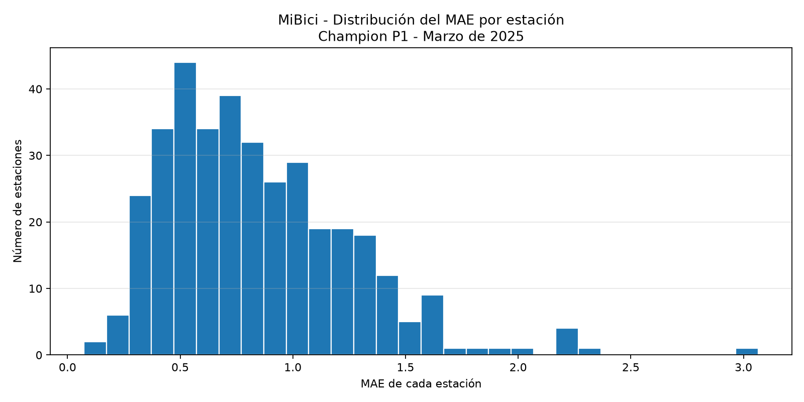
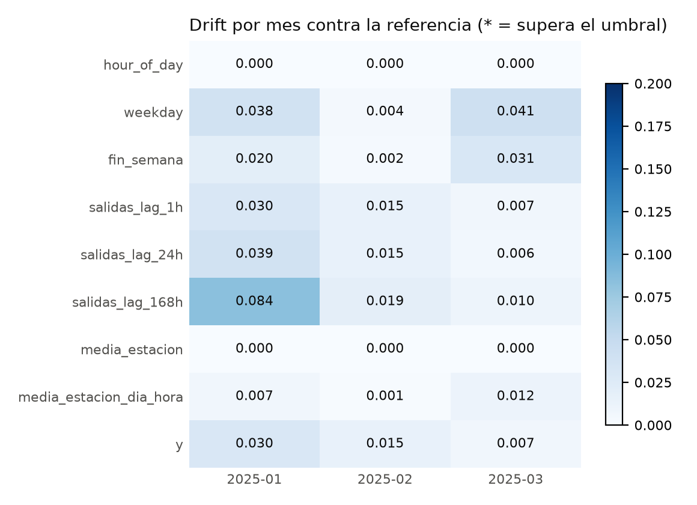
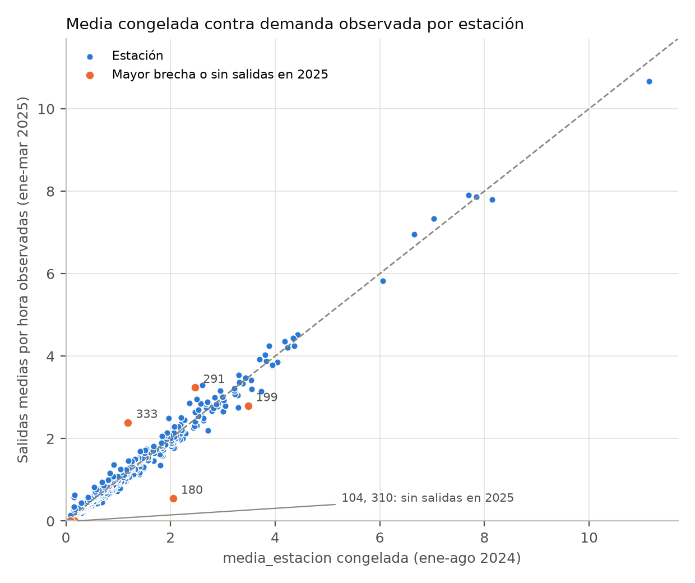

# Semana 9 — Análisis A/B del modelo P1 de MiBici

**Proyecto:** TC5061 — Equipo 15
**Estado del documento:** Análisis del Champion y monitoreo de drift integrados; comparación final con Challenger pendiente
**Rama de trabajo:** `feature/week9-ab-testing-A01797899`
**Modelo registrado:** `mibici-equipo15-p1-demanda`
**Periodo de evaluación:** 1 al 31 de marzo de 2025

> **Alcance actual.** Este documento integra la evaluación reproducible del Champion P1 en marzo de 2025 con el monitoreo de drift sobre datos de referencia de 2024 y datos actuales de enero a marzo de 2025. También incorpora el análisis conjunto de demanda, errores y medias históricas por estación. La comparación offline con el Challenger y la recomendación definitiva de promoción permanecen pendientes. Los resultados de drift y de desempeño son análisis diferentes y no implican causalidad.

## 1. Objetivo

En esta actividad buscamos evaluar si un modelo Challenger P1, reentrenado con información más reciente de MiBici, mejora el desempeño del Champion original. Como primera fase, establecimos una línea base reproducible del Champion sobre un conjunto de datos reservado de marzo de 2025. Posteriormente utilizaremos exactamente las mismas observaciones para comparar ambos modelos y contextualizar los resultados con el reporte de drift.

La comparación prevista es una **evaluación A/B offline y pareada**: los modelos producen predicciones sobre las mismas observaciones históricas. No se trata de un experimento online con asignación aleatoria de tráfico.

## 2. Datos y contrato de evaluación

Reutilizamos la preparación de datos de la Semana 9, incorporada mediante el PR #30. El proceso generó los siguientes conjuntos:

| Archivo | Periodo | Registros | Estaciones | Uso |
|---|---|---:|---:|---|
| `reference_p1.parquet` | 8 de enero–31 de agosto de 2024 | 2,059,056 | 362 | Referencia histórica |
| `current_p1.parquet` | Enero–marzo de 2025 | 781,920 | 362 | Monitoreo de drift |
| `train_alternative.parquet` | Enero–febrero de 2025 | 512,592 | 362 | Entrenamiento del Challenger |
| `evaluation.parquet` | 1–31 de marzo de 2025 | **269,328** | **362** | Evaluación común |

La evaluación contiene 744 registros horarios por estación (31 días × 24 horas) y utiliza estas ocho características P1, con tipo `float64`:

1. `hour_of_day`
2. `weekday`
3. `fin_semana`
4. `salidas_lag_1h`
5. `salidas_lag_24h`
6. `salidas_lag_168h`
7. `media_estacion`
8. `media_estacion_dia_hora`

La variable objetivo es `y`, correspondiente al número real de salidas por estación-hora. Se conservan `station` y `hour` para las comparaciones por segmento. El proceso de preparación informó ausencia de nulos en las características y particiones temporales sin superposición. La suite de datos confirmó el contrato con **16 pruebas satisfactorias**.

**Reproducibilidad:** el conjunto de evaluación se genera localmente en `data/processed/week9/evaluation.parquet`; los CSV descargados y el Parquet de 2024 no se agregan al repositorio. El manifiesto de preparación local se encuentra en `data/processed/week9/manifiesto_local.json`. El comparador también escribe el SHA-256 del archivo evaluado en `champion_baseline.json`.

## 3. Modelo Champion y procedimiento de inferencia

Recuperamos el Champion desde MLflow Model Registry, usando la base y los artefactos locales de la Semana 8:

| Propiedad | Valor comprobado |
|---|---|
| Nombre registrado | `mibici-equipo15-p1-demanda` |
| Alias | `champion` |
| Versión | **1** |
| Run ID | `6e3429f222a0407aa159dd9f46699365` |
| URI de evaluación | `models:/mibici-equipo15-p1-demanda/1` |
| Firma de entrada | Ocho variables `double` requeridas |
| Estado registrado | `READY` |

El módulo `scripts/week9/compare_models.py` carga una versión explícita, ordena las entradas por estación y hora, predice por lotes de 10,000 filas y aplica `np.clip(predicciones, 0, None)` al resultado, de acuerdo con el tratamiento utilizado por el servicio de inferencia existente.

```bash
python -m scripts.week9.compare_models \
  --data data/processed/week9/evaluation.parquet \
  --output reports/week9/ab_testing \
  --tracking-uri http://127.0.0.1:5000 \
  --mode champion \
  --batch-size 10000
```

## 4. Métricas globales del Champion

Medimos el **error absoluto medio (MAE)** y la **raíz del error cuadrático medio (RMSE)** sobre las 269,328 observaciones de marzo:

| Métrica | Resultado |
|---|---:|
| **MAE** | **0.8406793191283037** |
| **RMSE** | **1.4369529768005689** |
| Observaciones | 269,328 |
| Estaciones | 362 |
| Periodo | 2025-03-01 a 2025-03-31 |

Ambas métricas están expresadas en salidas por estación-hora. El RMSE penaliza más los errores grandes; su valor superior al MAE es consistente con la existencia de observaciones con desviaciones elevadas. Estos valores constituyen **la línea base**, no la comparación A/B final.

### 4.1. Verificación independiente de reproducibilidad

Ejecutamos dos implementaciones: `scripts/week9/evaluate_champion.py` y `scripts/week9/compare_models.py`. Obtuvimos exactamente las mismas métricas:

| Métrica | Evaluación inicial | Comparador | Diferencia |
|---|---:|---:|---:|
| MAE | 0.8406793191283037 | 0.8406793191283037 | **0.0** |
| RMSE | 1.4369529768005689 | 1.4369529768005689 | **0.0** |

El chequeo automatizado concluyó con el mensaje `VALIDACIÓN: métricas reproducidas correctamente`. Los archivos asociados son `champion_march_2025.json` y `champion_baseline.json`.

## 5. Análisis de demanda y error por día

Generamos dos visualizaciones a partir de las predicciones reales: `champion_actual_vs_predicted.png` y `champion_daily_mae.png`. La primera muestra que el Champion sigue el patrón general semanal de utilización, aunque presenta diferencias en algunos días. La segunda permite observar la variación del MAE a lo largo del mes y la referencia global de 0.8407.


Los cinco días con mayor MAE fueron:

| Fecha | Salidas reales | Predicción total del Champion | MAE diario | RMSE diario |
|---|---:|---:|---:|---:|
| **2025-03-17** | **7,968** | **13,077.54** | **1.0363** | **1.7685** |
| 2025-03-03 | 15,026 | 13,947.51 | 0.9152 | 1.5388 |
| 2025-03-18 | 15,380 | 14,298.10 | 0.9142 | 1.5258 |
| 2025-03-05 | 15,100 | 14,660.98 | 0.9091 | 1.5498 |
| 2025-03-11 | 15,481 | 15,015.92 | 0.9087 | 1.5550 |

**Hallazgo del 17 de marzo.** En esa fecha, el modelo predijo aproximadamente 5,110 salidas más que las observadas al sumar las predicciones por estación-hora. El MAE diario de 1.0363 fue el más alto del mes. La diferencia de totales diarios no debe confundirse con el MAE: la primera permite compensaciones entre errores positivos y negativos, mientras que el MAE promedia sus magnitudes absolutas.

Como hipótesis de análisis, conviene revisar las particularidades del calendario y de la operación del sistema en esa fecha. No podemos atribuir el desajuste a una festividad o al drift sin evidencia adicional.

## 6. Análisis por estación

Calculamos el error de las 362 estaciones con 744 horas de evaluación por estación. La distribución presenta una cola hacia valores altos, lo que indica heterogeneidad entre estaciones.



Las diez estaciones con mayor MAE fueron:

| Estación | Observaciones | MAE | RMSE |
|---:|---:|---:|---:|
| **51** | 744 | **3.0654** | **4.8427** |
| 11 | 744 | 2.2875 | 3.2717 |
| 35 | 744 | 2.2553 | 3.5635 |
| 194 | 744 | 2.2469 | 4.4079 |
| 50 | 744 | 2.2156 | 3.3068 |
| 271 | 744 | 2.2139 | 3.0656 |
| 54 | 744 | 1.9760 | 3.0327 |
| 52 | 744 | 1.9562 | 2.9457 |
| 260 | 744 | 1.7718 | 2.6678 |
| 34 | 744 | 1.7086 | 2.6932 |

Resumen del MAE por estación:

| Estadístico | MAE |
|---|---:|
| Media | 0.8407 |
| Desviación estándar | 0.4143 |
| Mínimo | 0.0734 |
| Cuartil 25 % | 0.5397 |
| Mediana | 0.7684 |
| Cuartil 75 % | 1.0721 |
| Máximo | 3.0654 |

La media supera la mediana, lo que es consistente con estaciones que concentran errores mayores. Sin embargo, un MAE alto puede estar asociado a mayor volumen de viajes, no necesariamente a una degradación relativa. Antes de recomendar acciones específicas, compararemos también la demanda observada y el error del Challenger en esas estaciones.

## 7. Exportaciones y verificación de integridad

La ejecución del comparador generó los siguientes resultados:

| Archivo | Contenido |
|---|---|
| `champion_baseline.json` | Modelo, versión, periodo, MAE, RMSE, hash y metadatos |
| `champion_predictions.parquet` | 269,328 predicciones por estación-hora y errores |
| `champion_daily_metrics.csv` | Resultados correspondientes a los 31 días |
| `champion_station_metrics.csv` | Resultados de 362 estaciones |
| `champion_actual_vs_predicted.png` | Serie diaria de demanda real y predicha |
| `champion_daily_mae.png` | MAE diario y referencia global |
| `champion_station_mae.png` | Distribución de MAE por estación |

La validación de exportaciones concluyó con **269,328 predicciones, 31 días, 362 estaciones** y el mensaje `VALIDACIÓN DE EXPORTACIONES CORRECTA`.

## 8. Pruebas automatizadas

Implementamos pruebas unitarias para métricas, porcentajes de mejora, predicciones por lotes, manejo de errores, validación de fechas, simulaciones del Model Registry y exportaciones CSV/Parquet.

Las pruebas que simulan MLflow (*mocks*) se conservarán como parte permanente de la suite, ya que comprueban errores y contratos sin depender de un servidor activo. Las pruebas de integración reales con el Challenger se añadirán por separado cuando su versión esté disponible.

| Suite | Resultado validado |
|---|---|
| `python -m pytest tests/test_week9_data.py -v` | 16 passed (validación de preparación de datos) |
| `python -m pytest tests/test_week9_drift.py -v` | **21 passed, 22 warnings**, en 31.29 s |
| `python -m pytest tests/test_week9_ab_testing.py -v` | **21 passed**, en 10.55 s |
| `python -m pytest -v` | **305 passed, 24 warnings**, en 50.97 s |

Las 305 pruebas de la suite completa pasaron después de incorporar el monitoreo de drift, sin fallos ni pruebas omitidas. Las advertencias proceden de bibliotecas de terceros, incluidas Evidently, Litestar, NumPy, pandas, Starlette y MLflow; deben registrarse como avisos de compatibilidad, sin confundirlas con pruebas fallidas. Las pruebas con mocks del Registry siguen siendo parte de la validación unitaria y no sustituyen futuras pruebas de integración con el Challenger.

## 9. Evidencias disponibles

Las capturas se organizan en `reports/week9/evidence/ab_testing/` y se conservarán junto con los archivos originales de los resultados:

| Evidencia | Archivo propuesto | Contenido |
|---|---|---|
| 01 | `01_champion_march_2025.png` | Primera evaluación del Champion |
| 02 | `02_champion_json_validation.png` | Validación del JSON de métricas |
| 03 | `03_ab_testing_unit_tests.png` | 13 primeras pruebas del comparador |
| 04 | `04_ab_testing_full_test_suite.png` | Suite previa de 276 pruebas |
| 05 | `05_champion_baseline_reproducibility.png` | Diferencias MAE/RMSE iguales a cero |
| 06 | `06_ab_comparator_champion_execution.png` | Ejecución del comparador |
| 07 | `07_mlflow_registry_mock_tests.png` | 18 pruebas del módulo A/B |
| 08 | `08_full_suite_registry_tests.png` | Suite de 281 pruebas |
| 09 | `09_champion_prediction_exports.png` | Exportación de predicciones |
| 09b | `09b_champion_exports_validation.png` | Validación de filas, días y estaciones |
| 10 | `10_champion_daily_visualizations.png` | Curvas diarias y MAE |
| 11 | `11_champion_station_mae.png` | Histograma por estación |
| 12 | `12_champion_exports_tests.png` | 21 pruebas A/B |
| 13 | `13_full_suite_after_exports.png` | Suite de 284 pruebas |

**Nota:** estas evidencias corresponden a la evaluación del Champion. El monitoreo de drift dispone adicionalmente de tres capturas en `reports/week9/evidence/drift/` y de cinco gráficas en `reports/week9/drift/figures/`. Los archivos de evidencia del módulo A/B se han verificado visualmente durante el desarrollo local, pero su publicación en Git queda pendiente. No se incluye evidencia de Ruff.

## 10. Monitoreo de drift y calidad de datos

### 10.1. Alcance y metodología

El monitoreo de drift se implementó con **Evidently 0.7.23**, mediante `DataDriftPreset` y `DataSummaryPreset`, y está documentado en `docs/week9/drift_monitoring.md`. Se compararon las **ocho características del modelo P1 y la variable objetivo `y`**, excluyendo los identificadores `station` y `hour` del cálculo de drift por variable. Se consideraron tres perspectivas:

| Escenario | Referencia | Conjunto actual | Finalidad |
|---|---|---|---|
| Principal | 8 ene.–31 ago. 2024; 2,059,056 registros | 1 ene.–31 mar. 2025; 781,920 registros | Comparar el entrenamiento del Champion con un periodo posterior |
| Control estacional | 8 ene.–31 mar. 2024; 729,792 registros | 1 ene.–31 mar. 2025; 781,920 registros | Disminuir el efecto de comparar estaciones distintas del año |
| Análisis mensual | Entrenamiento de 2024 | Enero, febrero y marzo de 2025 por separado | Identificar concentraciones temporales del cambio |

Para `hour_of_day`, `weekday` y `fin_semana` se utilizó **distancia de Jensen–Shannon**; para las variables de rezagos, medias históricas y `y`, **distancia de Wasserstein normalizada**. Se estableció un **umbral de 0.1** para declarar drift por columna y una proporción de **0.5** para declarar drift del conjunto.

La decisión metodológica de utilizar distancias, en lugar de interpretar exclusivamente valores *p*, permite valorar la magnitud de los cambios en conjuntos de gran tamaño. Los resultados dependen de estas métricas y de sus umbrales: no detectar drift no equivale a demostrar que las distribuciones son idénticas.

### 10.2. Resultados por variable

| Variable | Escenario principal | Control estacional | Máximo mensual identificado |
|---|---:|---:|---:|
| `hour_of_day` | 0.000 | 0.000 | 0.000 |
| `weekday` | 0.011 | 0.010 | 0.041 (marzo) |
| `fin_semana` | 0.005 | 0.002 | 0.031 (marzo) |
| `salidas_lag_1h` | 0.006 | 0.015 | 0.030 (enero) |
| `salidas_lag_24h` | 0.009 | 0.018 | 0.039 (enero) |
| `salidas_lag_168h` | **0.020** | **0.034** | **0.084 (enero)** |
| `media_estacion` | 0.000 | 0.000 | 0.000 |
| `media_estacion_dia_hora` | 0.002 | 0.001 | 0.012 (marzo) |
| `y` (demanda real) | 0.006 | 0.015 | 0.030 (enero) |

**Hallazgo: no se detectó drift global bajo la configuración establecida.** Ninguna de las nueve variables superó el umbral de 0.1 en el escenario principal, el control estacional o las evaluaciones mensuales. El mayor puntaje (0.084) apareció en enero para `salidas_lag_168h`; fue menor que el umbral y disminuyó a 0.020 en febrero y 0.010 en marzo. Esta evolución no muestra una tendencia de aumento sostenido durante el trimestre.

La demanda promedio pasó de **1.476 a 1.465 salidas por estación-hora** (aproximadamente **−0.7 %**) entre la referencia y el periodo actual. La proporción de horas sin salidas pasó de 52.1 % a 52.4 %. Las distribuciones agregadas se mantuvieron próximas, aunque esta similitud no descarta cambios importantes en estaciones particulares.




### 10.3. Calidad, controles y limitaciones del monitoreo

Los conjuntos reportan **cero nulos, cero duplicados de la llave estación-hora, cero valores fuera de los rangos examinados y tipos `float64`** en las ocho características P1. Asimismo, se conservaron las 362 estaciones del contrato de evaluación.

El resumen de Evidently incluye algunas pruebas auxiliares de `DataSummaryPreset` marcadas como `FAIL`: cinco en el escenario principal y cuatro en el estacional. Esos resultados se relacionan principalmente con el distinto número de registros por periodo y con diferencias entre valores máximos puntuales (`86` en la referencia frente a `71` en 2025). **No son fallos de Pytest ni contradicen la ausencia de drift estadístico con el umbral seleccionado.** Requieren interpretación contextual; no deben ocultarse ni calificarse automáticamente como errores de datos.

Además, el cambio próximo a cero de `media_estacion` y `media_estacion_dia_hora` merece una advertencia metodológica: **son medias históricas congeladas del entrenamiento**, por lo que su distribución puede permanecer estable aun cuando la demanda observada de estaciones individuales haya cambiado. Por ello se realizó un análisis complementario por estación.

### 10.4. Cambios locales de demanda y medias congeladas

El análisis por estación detectó **44 de 362 estaciones con cambios superiores al 20 % en magnitud**, y **11 con variaciones superiores al 50 %**. Las estaciones 104 y 310 no registraron salidas en enero–marzo de 2025.

| Estación | Cambio de demanda 2024 → ene.–mar. 2025 | MAE Champion en marzo | Brecha absoluta respecto a media congelada |
|---:|---:|---:|---:|
| 180 | **−73.48 %** | 1.5340 | **1.5029** |
| 333 | **+98.69 %** | 1.5323 | **1.1998** |
| 389 | +265.43 % | 0.5730 | 0.4222 |
| 390 | +261.23 % | 0.6367 | 0.4634 |
| 104 | −100.00 % | 0.0734 | 0.0879 |
| 310 | −100.00 % | 0.1338 | 0.1663 |

La brecha absoluta promedio de la media histórica congelada respecto a la demanda observada fue aproximadamente **0.123 salidas por estación-hora**. Estos resultados muestran que una distribución agregada relativamente estable puede ocultar diferencias operativas relevantes por estación.

Los porcentajes extremos de algunas estaciones deben interpretarse junto con sus niveles absolutos de demanda, porque incrementos grandes respecto de bases pequeñas no necesariamente generan errores absolutos grandes. El MAE reducido de las estaciones sin salidas también es compatible con predicciones positivas pequeñas, sin implicar que el modelo se haya adaptado a la ausencia de actividad.



## 11. Análisis conjunto de drift y desempeño del Champion

### 11.1. Integración reproducible de resultados

Se integraron por la clave `station` los archivos:

- `reports/week9/ab_testing/champion_station_metrics.csv`: MAE y RMSE calculados con **marzo de 2025**.
- `reports/week9/drift/demanda_por_estacion.csv`: demanda y diferencias por estación entre **la referencia de 2024 y enero–marzo de 2025**.

La unión uno-a-uno produjo **362 estaciones coincidentes de 362 esperadas**, sin pérdida de estaciones. El resultado quedó guardado en `reports/week9/ab_testing/station_drift_vs_mae.csv`.

**Precisión temporal:** las métricas de error corresponden únicamente a marzo, mientras que las medidas de cambio de demanda abarcan enero–marzo. Por lo tanto, el análisis de asociaciones es exploratorio y no debe describirse como una comparación de periodos perfectamente equivalentes.

### 11.2. Correlaciones entre MAE y variables de demanda

Calculamos correlaciones de Pearson a nivel de estación para analizar qué variables se asocian con el error absoluto del Champion:

| Asociación con el MAE | Coeficiente de Pearson | Lectura descriptiva |
|---|---:|---|
| Demanda media actual (`demanda_act`) | **+0.9485** | Asociación positiva muy fuerte |
| Brecha absoluta de media congelada (`abs(brecha_congelada)`) | **+0.4321** | Asociación positiva moderada |
| Cambio porcentual absoluto (`abs(cambio_pct)`) | **−0.1963** | Asociación negativa débil |
| Brecha congelada con signo (`brecha_congelada`) | **−0.0148** | Asociación lineal prácticamente nula |

**Hallazgo central: el MAE absoluto está fuertemente asociado con el volumen de demanda.** Las estaciones con mayor utilización suelen concentrar mayores errores absolutos, aunque esto no demuestra que sus predicciones sean peores en términos relativos. La estación 51, por ejemplo, tuvo el mayor MAE (**3.0654**) y una variación de demanda de solo **−5.00 %**. Entre las cinco estaciones con mayor MAE, los cambios de demanda fueron relativamente moderados.

La **brecha absoluta de la media congelada** presenta una asociación moderada con el error (**0.4321**), mientras que la brecha con signo prácticamente no tiene correlación lineal (**−0.0148**). La diferencia indica que la *magnitud* de las desviaciones es más informativa que su dirección, pero **no demuestra un efecto causal independiente** del volumen de demanda. Las correlaciones bivariadas no controlan simultáneamente por la escala de actividad, otros factores ni dependencia temporal.

La relación débilmente negativa del MAE con el **cambio porcentual absoluto** (**−0.1963**) confirma que una estación puede experimentar variaciones relativas grandes sin presentar necesariamente un MAE absoluto elevado. Este comportamiento hace inadecuado usar el porcentaje de cambio como único indicador de desempeño.

### 11.3. Estaciones relevantes para el seguimiento

Las cinco estaciones con mayor MAE fueron:

| Estación | MAE | RMSE | Cambio porcentual de demanda |
|---:|---:|---:|---:|
| 51 | **3.0654** | 4.8427 | −5.0031 % |
| 11 | 2.2875 | 3.2717 | −0.4887 % |
| 35 | 2.2553 | 3.5635 | +1.8539 % |
| 194 | 2.2469 | 4.4079 | −5.3021 % |
| 50 | 2.2156 | 3.3068 | +3.9468 % |

En cambio, las estaciones **180 y 333** destacan por el envejecimiento de las medias históricas: registraron las mayores brechas absolutas (**1.5029 y 1.1998**) y cambios pronunciados de demanda (**−73.48 % y +98.69 %**, respectivamente). Ambas presentaron un MAE cercano a **1.53** en marzo.

También identificamos que las estaciones **389 y 390** experimentaron aumentos porcentuales superiores al 260 %, pero mantuvieron MAE de **0.5730 y 0.6367**, inferiores al promedio global. Por el contrario, las estaciones de mayor MAE no fueron las de mayor cambio porcentual. Estos contrastes muestran la necesidad de separar el análisis por **volumen**, **cambio relativo** y **error absoluto**.

Las diez estaciones con mayor brecha absoluta fueron 180, 333, 291, 179, 199, 196, 86, 20, 2 y 43. El archivo combinado permite reproducir estos ordenamientos y ampliar el análisis cuando se disponga del Challenger.

### 11.4. Implicaciones para monitoreo y Continuous Training

Los resultados obtenidos permiten formular orientaciones preliminares, **no una decisión definitiva de promoción**:

1. Mantener el monitoreo agregado de Evidently, pero complementarlo con indicadores de demanda, errores y brechas por estación.
2. Evaluar periódicamente si las medias históricas congeladas siguen representando la operación reciente; considerar su recalibración o el reentrenamiento sin utilizar observaciones del periodo reservado para evaluación.
3. Vigilar segmentos especiales como estaciones sin salidas, estaciones con cambios pronunciados y jornadas con errores inusuales, en particular el 17 de marzo.
4. Complementar el MAE con métricas relativas o normalizadas por volumen —por ejemplo WAPE por estación o por grupos de demanda, siempre definiendo cómo tratar demandas nulas— antes de comparar estaciones de distinta escala.
5. Condicionar cualquier recomendación de promoción del Challenger a una reducción comprobada y suficientemente consistente de MAE/RMSE en **las mismas 269,328 observaciones**, sin deterioros críticos en segmentos relevantes.

**Interpretación integrada:** la ausencia de drift global con umbral 0.1 no descarta cambios locales, del mismo modo que el MAE alto de una estación no demuestra degradación relativa. El análisis indica dónde profundizar, pero no identifica por sí solo causas definitivas ni garantiza beneficios del reentrenamiento.

## 12. Comparación A/B pendiente y criterios de decisión

### 12.1. Evaluación del Challenger

La comparación offline pareada sigue pendiente de disponer de una versión Challenger accesible desde MLflow. Una vez disponible, utilizaremos `scripts/week9/compare_models.py --mode both` sobre el mismo `evaluation.parquet`, identificando versiones explícitas para asegurar reproducibilidad.

| Métrica | Champion marzo 2025 | Challenger | Mejora porcentual |
|---|---:|---|---|
| MAE | **0.8406793191283037** | Pendiente | Pendiente |
| RMSE | **1.4369529768005689** | Pendiente | Pendiente |
| Observaciones | **269,328** | Las mismas 269,328 | — |
| Estaciones | **362** | Las mismas 362 | — |

La mejora de una métrica de error se definirá como `(error_Champion − error_Challenger) / error_Champion × 100`. También verificaremos las diferencias por día, por estación y por grupos de volumen, en especial los casos 17 de marzo, 51, 180 y 333. Los posibles intervalos de incertidumbre deberán respetar la dependencia temporal y por estación de las observaciones.

### 12.2. Recomendación operativa

**Todavía no se recomienda promover ni descartar el Challenger.** La decisión definitiva requerirá métricas comparables, revisión de degradaciones locales, validación de contratos y reproducibilidad, y discusión conjunta con los hallazgos del monitoreo. No se cambiará automáticamente el alias `champion` como parte de este análisis.

## 13. Limitaciones del análisis

- La evaluación offline del Champion se efectuó sobre un solo mes (marzo de 2025); no constituye una prueba de producción en línea ni una asignación aleatoria de tráfico.
- El monitoreo de drift comparó periodos de distinta duración; el control estacional reduce, pero no elimina, diferencias temporales y efectos del calendario.
- La declaración de ausencia de drift es válida para las variables, las distancias y los umbrales configurados; no prueba equivalencia estadística absoluta.
- Los cambios de demanda por estación corresponden a enero–marzo de 2025, mientras que el MAE por estación corresponde solo a marzo. Esta desalineación temporal limita la interpretación de las correlaciones.
- Las correlaciones son descriptivas, no causales; el fuerte vínculo entre MAE y volumen advierte que los errores absolutos son sensibles a la escala de demanda.
- Los porcentajes de cambio pueden amplificarse ante bases de demanda pequeñas. La brecha con signo y la absoluta responden a preguntas diferentes.
- La investigación del 17 de marzo y de los posibles factores de calendario permanece abierta; no se ha atribuido el error de esa fecha a un evento específico.
- La comparación final del Challenger aún no se ha ejecutado; por lo tanto, no existe evidencia suficiente para afirmar que el reentrenamiento mejora el desempeño.

## 14. Conclusiones preliminares integradas

Durante esta etapa construimos una línea base reproducible del Champion P1 sobre marzo de 2025, con **269,328 observaciones de 362 estaciones**, obteniendo **MAE = 0.8407** y **RMSE = 1.4370**. Confirmamos la reproducción exacta de ambas métricas con dos implementaciones y exportamos predicciones, métricas diarias y por estación, además de visualizaciones. El **17 de marzo** presentó el mayor MAE diario (**1.0363**) y la estación **51** el mayor MAE por estación (**3.0654**).

Integramos el monitoreo con Evidently sobre los datos de entrenamiento de 2024 y el trimestre enero–marzo de 2025. **Ninguna de las nueve variables evaluadas superó el umbral de drift de 0.1**, incluso al aplicar el control estacional y el seguimiento mensual. A pesar de ello, identificamos variaciones importantes en determinadas estaciones y brechas entre la demanda reciente y las medias históricas congeladas del Champion.

Al cruzar los resultados de monitoreo y desempeño para las **362 estaciones**, observamos una correlación **muy fuerte entre MAE y volumen de demanda (r = 0.9485)**, una correlación **moderada con la brecha absoluta de las medias congeladas (r = 0.4321)** y una relación **débil con el cambio porcentual absoluto (r = −0.1963)**. Estos hallazgos evidencian que el error absoluto y los cambios relativos describen fenómenos diferentes; por ello, el monitoreo global debe complementarse con análisis segmentados y métricas ajustadas a la escala de demanda.

La integración técnica se verificó con **305 pruebas automatizadas satisfactorias**, incluidas las 21 pruebas del monitoreo y las 21 pruebas del módulo A/B, sin fallos. Concluimos que el análisis del Champion y del drift está integrado y documentado, mientras que la selección de un modelo definitivo deberá fundamentarse en la **comparación real con el Challenger**, aún pendiente.

---

**Pendiente antes de finalizar la entrega:** ejecutar la comparación Champion–Challenger sobre marzo de 2025, incorporar sus métricas y gráficas comparativas, elaborar una recomendación basada en los resultados, verificar las evidencias finales y repetir las pruebas después de integrar cualquier cambio adicional.
