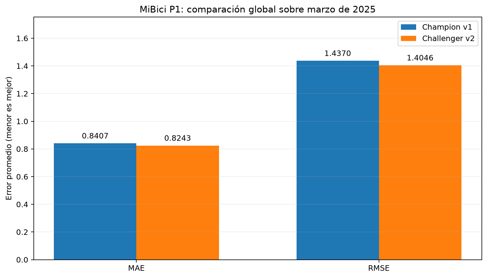
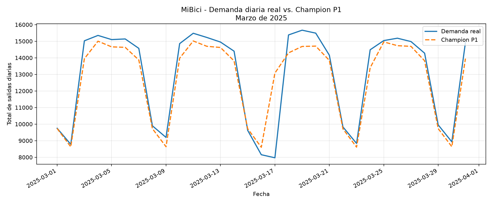
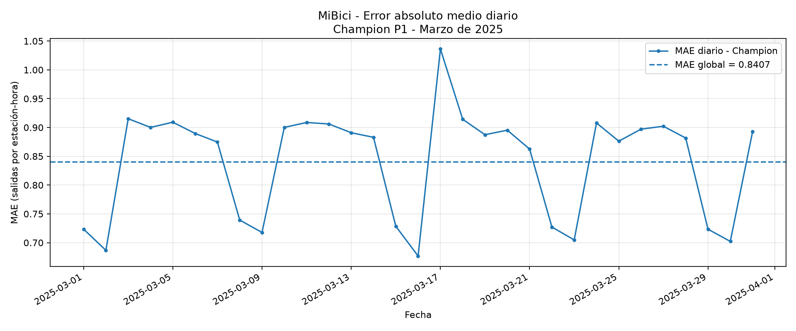
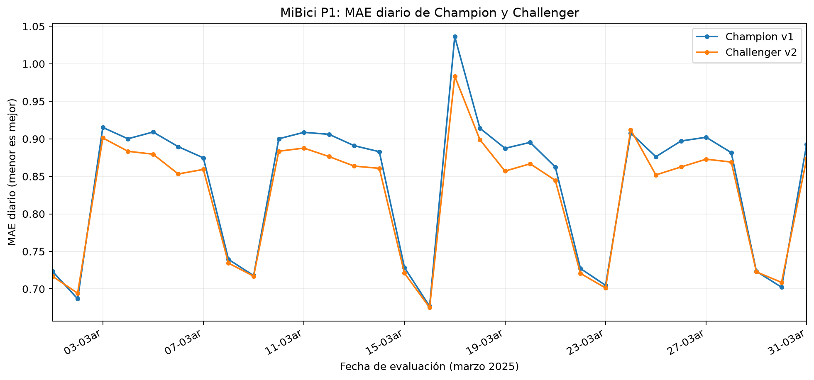
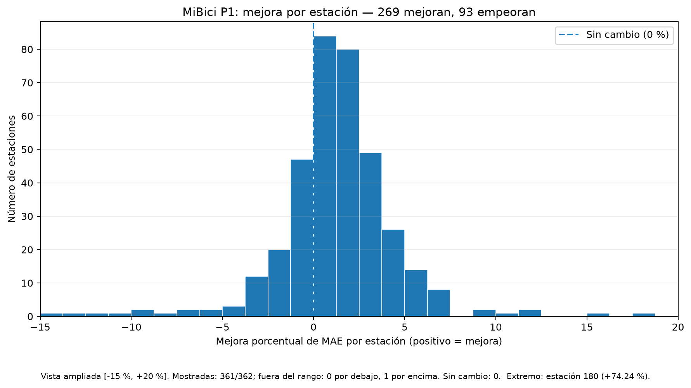
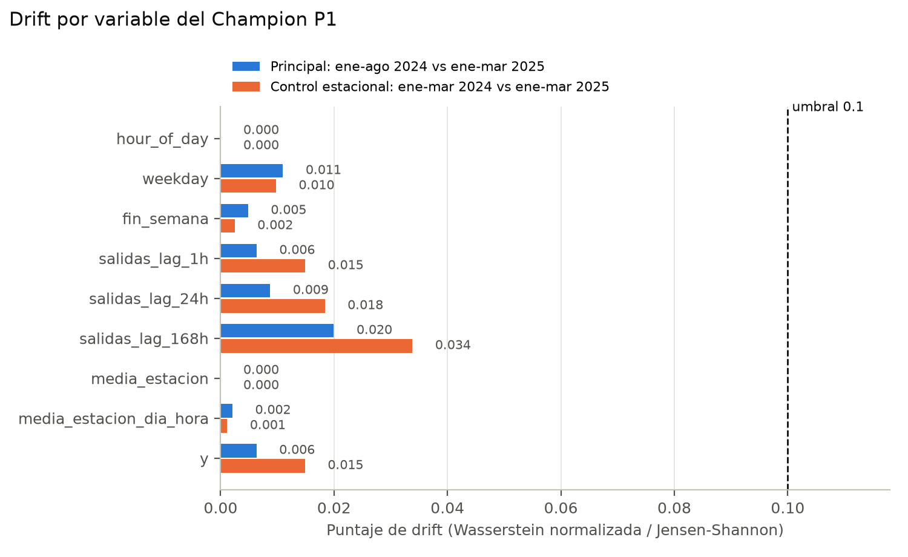
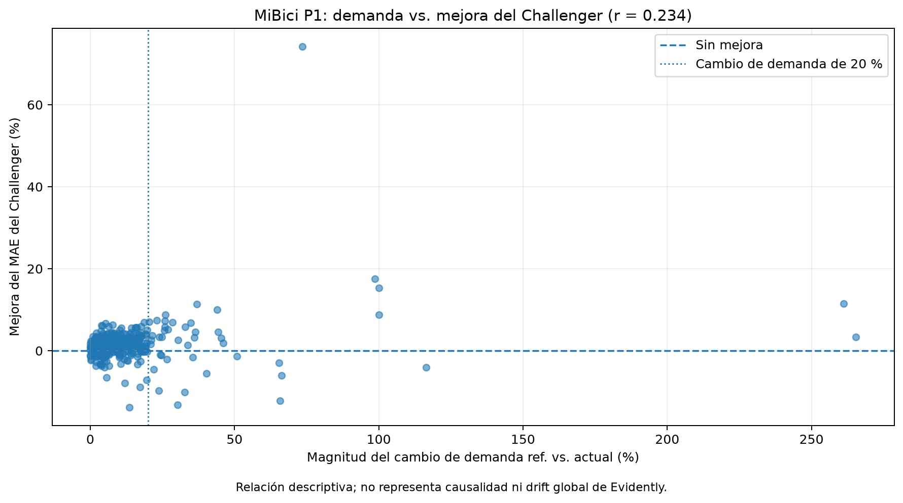

# Semana 9 — Análisis A/B del modelo P1 de MiBici

**Proyecto:** TC5061 — Equipo 15
**Estado del documento:** Evaluación offline Champion–Challenger y análisis integrado con drift completados
**Modelo registrado:** `mibici-equipo15-p1-demanda`
**Periodo de evaluación:** 1 al 31 de marzo de 2025
**Tipo de evaluación:** Comparación A/B *offline* y pareada (sin asignación aleatoria de tráfico)

> **Alcance.** Evaluamos el Champion P1 (versión 1) frente al Challenger (versión 2) sobre las mismas 269,328 observaciones de marzo de 2025. Integramos resultados globales, diarios y por estación con el monitoreo de drift realizado mediante Evidently. El Challenger presentó menores errores agregados, pero la evidencia es *offline*, limitada a marzo de 2025, y no implica una promoción automática ni un cambio del alias `champion`.

## 1. Objetivo

En esta actividad buscamos determinar si el reentrenamiento de P1 con datos recientes de MiBici aporta mejoras de desempeño frente al modelo Champion previamente registrado. Primero construimos una línea base reproducible del Champion y, después, registramos el Challenger y realizamos una evaluación pareada sobre el conjunto reservado de marzo de 2025. Complementamos la comparación con los cambios de demanda y las señales de drift observados en el monitoreo de la Semana 9.

La comparación es **offline y pareada**: los dos modelos generan predicciones sobre las mismas observaciones históricas. Aunque se denomine A/B Testing en la actividad, **no es un experimento online con usuarios, tráfico aleatorizado ni evidencia de impacto en producción**.

## 2. Datos y contrato de evaluación

Reutilizamos los conjuntos preparados en la Semana 9 (PR #30):

| Archivo | Periodo | Registros | Estaciones | Uso |
|---|---|---:|---:|---|
| `reference_p1.parquet` | 8 ene.–31 ago. de 2024 | 2,059,056 | 362 | Referencia histórica del Champion |
| `current_p1.parquet` | Ene.–mar. de 2025 | 781,920 | 362 | Monitoreo de drift |
| `train_alternative.parquet` | Ene.–feb. de 2025 | 512,592 | 362 | Entrenamiento del Challenger |
| `evaluation.parquet` | 1–31 mar. de 2025 | **269,328** | **362** | Evaluación pareada de ambos modelos |

El conjunto reservado tiene **744 registros horarios por estación** (31 días × 24 horas). El contrato P1 contiene ocho características numéricas `float64`:

1. `hour_of_day`
2. `weekday`
3. `fin_semana`
4. `salidas_lag_1h`
5. `salidas_lag_24h`
6. `salidas_lag_168h`
7. `media_estacion`
8. `media_estacion_dia_hora`

La variable objetivo es `y` (salidas por estación-hora). Utilizamos `station` y `hour` para evaluar segmentos y series temporales. Comprobamos la ausencia de superposición entre el entrenamiento del Challenger, cuyo último registro es el **28 de febrero de 2025 a las 23:00**, y el periodo reservado, que inicia el **1 de marzo de 2025 a las 00:00**. Los datos de marzo no se incorporaron al entrenamiento.

El conjunto de evaluación se genera localmente en `data/processed/week9/evaluation.parquet`; los CSV de origen y algunos artefactos voluminosos no forman parte del repositorio. El manifiesto de preparación local es `data/processed/week9/manifiesto_local.json`. Para trazabilidad, `comparison_metrics.json` almacena la huella SHA-256 del Parquet evaluado. La preparación original se respaldó además con **16 pruebas satisfactorias** de calidad y contrato de datos.

## 3. Modelos registrados y procedimiento de inferencia

### 3.1. Champion P1

Recuperamos el Champion mediante MLflow Model Registry, usando la base y artefactos locales de Semana 8:

| Propiedad | Valor comprobado |
|---|---|
| Modelo | `mibici-equipo15-p1-demanda` |
| Alias | `champion` |
| Versión | **1** |
| Run ID | `6e3429f222a0407aa159dd9f46699365` |
| URI | `models:/mibici-equipo15-p1-demanda/1` |
| Firma | Ocho características P1 requeridas |
| Estado | `READY` |

La línea base se calculó con el siguiente comando:

```bash
python -m scripts.week9.compare_models \
  --data data/processed/week9/evaluation.parquet \
  --output reports/week9/ab_testing \
  --tracking-uri http://127.0.0.1:5000 \
  --mode champion \
  --batch-size 10000
```

### 3.2. Challenger P1 y reproducibilidad del reentrenamiento

El Challenger se entrenó con las **512,592 observaciones de enero–febrero de 2025**, utilizando el mismo contrato de ocho características y el algoritmo `HistGradientBoostingRegressor`, con `max_iter=300`, `learning_rate=0.1`, `max_depth=None`, `early_stopping=False` y `random_state=42`. Este entrenamiento se ejecutó con `scripts/week9/train_challenger.py`, integrado mediante el PR #33.

```bash
python -m scripts.week9.train_challenger \
  --data data/processed/week9/train_alternative.parquet \
  --tracking-uri http://127.0.0.1:5000
```

Las métricas de **entrenamiento** reproducidas coincidieron numéricamente con las documentadas en el PR #33: **MAE = 0.7943356785109916** y **RMSE = 1.3130923736059918**. Estas métricas son distintas de las métricas del conjunto de evaluación y **no se utilizan para decidir qué modelo supera al otro**.

El modelo reentrenado se guardó en la ejecución local con Run ID `7074129578d045418cbed0691330d1a7` y Model ID `m-ea1a3789403948d08f509f0a562419e5`. Verificamos su estado `READY`, su firma de entrada y su capacidad para realizar inferencia. Posteriormente lo registramos como una nueva versión del mismo modelo P1.

| Propiedad | Champion | Challenger |
|---|---|---|
| Versión de Model Registry | **1** | **2** |
| Alias | `champion` | `challenger` |
| Run ID | `6e3429f222a0407aa159dd9f46699365` | `7074129578d045418cbed0691330d1a7` |
| URI de evaluación | `models:/mibici-equipo15-p1-demanda/1` | `models:/mibici-equipo15-p1-demanda/2` |
| Estado | `READY` | `READY` |

Corroboramos tanto por la API como por la interfaz de MLflow 3.16.1 que **`@champion` continúa apuntando a la versión 1** y **`@challenger` a la versión 2**. No promovimos el Challenger ni modificamos el alias de producción.

El comparador carga ambas versiones explícitas, realiza la inferencia por lotes de **10,000** observaciones y recorta predicciones negativas a cero mediante `np.clip(values, 0.0, None)` para aplicar el mismo posprocesamiento a ambos modelos.

### 3.3. Ejecución de la comparación pareada

```bash
python -m scripts.week9.compare_models \
  --data data/processed/week9/evaluation.parquet \
  --output reports/week9/ab_testing \
  --tracking-uri http://127.0.0.1:5000 \
  --mode both \
  --batch-size 10000
```

La evaluación se ejecutó y reprodujo sus métricas globales después de ampliar el comparador con la exportación de resultados por estación. `comparison_metrics.json` conserva las versiones, los Run IDs, las métricas, el periodo, el tamaño de lote, el tratamiento de negativos y la huella del conjunto evaluado.

## 4. Métricas globales del Champion y comparación definitiva

### 4.1. Línea base y verificación independiente del Champion

Sobre **269,328 observaciones**, el Champion obtuvo **MAE = 0.8406793191283037** y **RMSE = 1.4369529768005689**. Reprodujimos ambas métricas sin diferencias entre `scripts/week9/evaluate_champion.py` y `scripts/week9/compare_models.py` (diferencia absoluta: **0.0** en MAE y RMSE). Se conservaron `champion_march_2025.json` y `champion_baseline.json`.

### 4.2. Resultados A/B sobre marzo de 2025

| Métrica | Champion v1 | Challenger v2 | Mejora Challenger |
|---|---:|---:|---:|
| **MAE** | **0.8406793191** | **0.8243329534** | **+1.9444 %** |
| **RMSE** | **1.4369529768** | **1.4046436576** | **+2.2485 %** |
| Observaciones | 269,328 | 269,328 | Mismas observaciones |
| Estaciones | 362 | 362 | Mismas estaciones |
| Periodo | Marzo de 2025 | Marzo de 2025 | Mismo periodo |

Definimos la mejora porcentual de cada métrica de error como:

\[
\operatorname{Mejora}(\%)=\frac{\operatorname{Error}_{Champion}-\operatorname{Error}_{Challenger}}{\operatorname{Error}_{Champion}}\times100.
\]

Las reducciones absolutas aproximadas fueron **0.01635 salidas por estación-hora en MAE** y **0.03231 en RMSE**. Ambas métricas agregadas favorecen al Challenger; sin embargo, la magnitud de la mejora es moderada y requiere interpretación por día y por estación.



**Interpretación.** La gráfica reproduce los valores calculados sobre el conjunto reservado. El Challenger presenta barras más bajas tanto en MAE como en RMSE, pero esto no implica que mejore todas las estaciones ni todos los días.

## 5. Análisis de demanda y error por día

### 5.1. Comportamiento del Champion original

Conservamos las visualizaciones originales de demanda diaria y MAE del Champion:





Los cinco días con mayor MAE del Champion fueron:

| Fecha | Salidas reales | Predicción total Champion | MAE diario | RMSE diario |
|---|---:|---:|---:|---:|
| **2025-03-17** | **7,968** | **13,077.54** | **1.0363** | **1.7685** |
| 2025-03-03 | 15,026 | 13,947.51 | 0.9152 | 1.5388 |
| 2025-03-18 | 15,380 | 14,298.10 | 0.9142 | 1.5258 |
| 2025-03-05 | 15,100 | 14,660.98 | 0.9091 | 1.5498 |
| 2025-03-11 | 15,481 | 15,015.92 | 0.9087 | 1.5550 |

El **17 de marzo** presentó el mayor MAE diario del Champion y una diferencia de aproximadamente 5,110 salidas entre el total predicho y el total real. La diferencia de totales no es igual al MAE, que calcula el promedio de errores absolutos por estación-hora. No atribuimos esa anomalía a festividades, operación ni drift sin evidencia adicional.

### 5.2. Comparación diaria Champion vs. Challenger

El archivo `daily_metrics.csv` contiene las métricas diarias de ambos modelos para los **31 días** evaluados. Obtuvimos **28 días con menor MAE del Challenger (90.32 %)**, **3 con mayor MAE (9.68 %)** y ningún empate.



**Cinco mayores reducciones absolutas del MAE diario:**

| Fecha | MAE Champion | MAE Challenger | Reducción absoluta |
|---|---:|---:|---:|
| **2025-03-17** | 1.036268 | 0.983484 | **0.052784** |
| 2025-03-06 | 0.889616 | 0.853213 | 0.036403 |
| 2025-03-26 | 0.897143 | 0.862550 | 0.034593 |
| 2025-03-19 | 0.887399 | 0.857027 | 0.030372 |
| 2025-03-12 | 0.906044 | 0.876401 | 0.029643 |

**Días de deterioro del Challenger:**

| Fecha | MAE Champion | MAE Challenger | Cambio absoluto (Champion − Challenger) |
|---|---:|---:|---:|
| 2025-03-02 | 0.686773 | 0.694294 | **−0.007521** |
| 2025-03-30 | 0.702265 | 0.708728 | **−0.006463** |
| 2025-03-24 | 0.907828 | 0.912063 | **−0.004234** |

La reducción del MAE del **17 de marzo**, precisamente la fecha de mayor error del Champion, fortalece la evidencia a favor del Challenger. Sin embargo, los tres días con deterioro muestran que la ganancia no es uniforme y deben mantenerse dentro de los resultados del reporte.

## 6. Análisis por estación

### 6.1. Heterogeneidad del Champion

La evaluación original cubrió 362 estaciones, con 744 horas cada una. El Champion presentó una distribución sesgada hacia errores altos en algunas estaciones.


Las diez estaciones con mayor MAE del Champion fueron:

| Estación | Observaciones | MAE | RMSE |
|---:|---:|---:|---:|
| **51** | 744 | **3.0654** | **4.8427** |
| 11 | 744 | 2.2875 | 3.2717 |
| 35 | 744 | 2.2553 | 3.5635 |
| 194 | 744 | 2.2469 | 4.4079 |
| 50 | 744 | 2.2156 | 3.3068 |
| 271 | 744 | 2.2139 | 3.0656 |
| 54 | 744 | 1.9760 | 3.0327 |
| 52 | 744 | 1.9562 | 2.9457 |
| 260 | 744 | 1.7718 | 2.6678 |
| 34 | 744 | 1.7086 | 2.6932 |

El MAE por estación del Champion tuvo **media 0.8407**, desviación estándar **0.4143**, mediana **0.7684**, cuartiles **0.5397 y 1.0721**, mínimo **0.0734** y máximo **3.0654**. Un MAE elevado puede asociarse con mayor volumen de viajes, sin implicar necesariamente peor desempeño relativo.

### 6.2. Comparación A/B de las 362 estaciones

Ampliamos `scripts/week9/compare_models.py` para calcular, **sobre todas las observaciones de marzo**, MAE, RMSE, cantidad de registros y mejoras porcentuales por estación. El resultado es `station_comparison_metrics.csv`: **362 estaciones distintas, 269,328 observaciones y 744 registros por estación**.

| Resultado según MAE | Estaciones | Proporción |
|---|---:|---:|
| **Mejora con Challenger** | **269** | **74.31 %** |
| Deterioro con Challenger | 93 | 25.69 % |
| Sin diferencia | 0 | 0.00 % |



La figura muestra una **ventana ampliada de −15 % a +20 %** para facilitar la interpretación de la distribución principal. Se visualizan **361 de 362 estaciones**; la estación **180 (+74.24 %)** permanece **incluida en los datos, el análisis y los conteos**, aunque se indica fuera de los límites del histograma.

**Mayores mejoras porcentuales del Challenger:**

| Estación | MAE Champion | MAE Challenger | Mejora MAE |
|---:|---:|---:|---:|
| **180** | 1.534008 | 0.395127 | **+74.24 %** |
| 333 | 1.532301 | 1.263443 | +17.55 % |
| 310 | 0.133802 | 0.113286 | +15.33 % |
| 390 | 0.636690 | 0.563922 | +11.43 % |
| 348 | 0.340368 | 0.301891 | +11.38 % |

**Mayores deterioros porcentuales del Challenger:**

| Estación | MAE Champion | MAE Challenger | Mejora MAE |
|---:|---:|---:|---:|
| **146** | 0.249944 | 0.284436 | **−13.80 %** |
| 136 | 0.257848 | 0.291993 | −13.24 % |
| 220 | 0.315826 | 0.354228 | −12.16 % |
| 101 | 0.247838 | 0.272801 | −10.07 % |
| 365 | 0.291346 | 0.319811 | −9.77 % |

**Interpretación.** La mejora es frecuente, pero no universal. El deterioro en **93 estaciones** obliga a considerar medidas de monitoreo segmentado antes de una eventual promoción. Los porcentajes elevados también deben interpretarse junto con los errores absolutos y la demanda base.

## 7. Exportaciones y verificación de integridad

Los resultados se encuentran en `reports/week9/ab_testing/`:

| Archivo | Contenido |
|---|---|
| `champion_baseline.json`, `champion_march_2025.json` | Línea base del Champion y comprobación independiente |
| `champion_predictions.parquet` | Predicciones completas del Champion (artefacto local reproducible; no necesariamente versionado) |
| `champion_daily_metrics.csv`, `champion_station_metrics.csv` | Métricas originales por fecha y estación |
| `champion_actual_vs_predicted.png`, `champion_daily_mae.png`, `champion_station_mae.png` | Gráficas originales del Champion |
| `comparison_metrics.json` | Métricas globales A/B, versiones, Run IDs, periodo y SHA-256 |
| `daily_metrics.csv` | Comparación A/B durante 31 días |
| `predictions_sample.csv` | Muestra de 1,000 predicciones pareadas para inspección, **no para la inferencia de métricas por estación** |
| `station_comparison_metrics.csv` | MAE, RMSE y mejora del Challenger para las 362 estaciones, con todas sus observaciones |
| `station_drift_vs_mae.csv` | Integración histórica drift–error del Champion |
| `station_ab_drift_analysis.csv` | Unión A/B–demanda–drift para las 362 estaciones |
| `ab_final_global_mae_rmse.png` | Comparación global de MAE/RMSE |
| `ab_final_mae_diario.png` | MAE diario de ambos modelos |
| `ab_final_mejora_por_estacion.png` | Distribución ampliada de mejoras por estación |
| `ab_final_drift_vs_mejora_mae.png` | Cambio de demanda vs. mejora del Challenger |

Verificamos los conteos de **269,328 observaciones**, **31 días** y **362 estaciones**, las claves únicas por estación, la coincidencia de métricas del Champion en los archivos integrados y la ausencia de valores no finitos en los MAE y RMSE por estación. Las exportaciones adicionales se generan sin modificar las métricas globales de la comparación original.

## 8. Pruebas automatizadas

Conservamos las pruebas unitarias existentes de métricas, cálculo de mejora, validación de fechas, inferencia por lotes, posprocesamiento de negativos, contratos del Registry y exportaciones de Champion. El PR #33 añadió dos pruebas sobre el entrenamiento del Challenger; posteriormente incorporamos cuatro pruebas específicas de las exportaciones A/B definitivas en `tests/test_week9_ab_final.py`.

| Componente | Resultado validado |
|---|---|
| Preparación de datos (`tests/test_week9_data.py`) | 16 passed en validación previa |
| Drift (`tests/test_week9_drift.py`) | **21 passed**, 22 warnings en validación previa |
| A/B original (`tests/test_week9_ab_testing.py`) | **23 passed** después del PR #33 |
| Nuevas pruebas (`tests/test_week9_ab_final.py`) | **4 passed**, en 5.11 s |
| Ambas suites A/B | **27 passed**, en 8.69 s |
| Suite general (`python -m pytest -v`) | **311 passed, 24 warnings**, en 53.21 s |

Las cuatro pruebas nuevas verifican: (1) cálculos de MAE/RMSE y mejoras porcentuales por estación; (2) el caso en que el Champion tiene error cero y el porcentaje no está definido; (3) la utilización de **todo el conjunto**, en lugar de basarse únicamente en la muestra de 1,000 filas; y (4) la conservación de exportaciones y métricas globales originales.

Las advertencias proceden de bibliotecas externas, incluidas Evidently, Litestar, NumPy, pandas, Starlette y MLflow/SQLAlchemy. **No equivalen a fallos de prueba**. Las pruebas simuladas con *mocks* no sustituyen las verificaciones reales del Registry, de carga del Challenger y de inferencia, que documentamos por separado.

```bash
python -m pytest tests/test_week9_ab_final.py -v
python -m pytest tests/test_week9_ab_testing.py tests/test_week9_ab_final.py -v
python -m pytest -v
```

## 9. Evidencias de ejecución

Se conservan las evidencias originales `01` a `13` del PR #32 en `reports/week9/evidence/ab_testing/`: evaluación del Champion, reproducción del baseline, pruebas previas, métricas, gráficas y exportaciones. Se preservan sus nombres sin renumerarlas y sin incluir evidencia de Ruff. El análisis de drift cuenta con evidencias propias en `reports/week9/evidence/drift/`.

Las nuevas evidencias corresponden a la carpeta **`reports/week9/evidence/ab_testing/final/`**. La siguiente tabla refleja los archivos previstos/compartidos durante la validación local. **Su incorporación al repositorio debe verificarse antes del commit final**:

| Archivo | Evidencia |
|---|---|
| `14_rama_final_desde_main.png` | Preparación de rama a partir de `main` |
| `15_pr32_pr33_integrados.png` | Comprobación de integración de PR #32 y PR #33 |
| `16_pruebas_ab_23_passed.png` | Pruebas A/B tras integrar el Challenger |
| `17_pruebas_drift_21_passed.png` | Pruebas Evidently |
| `18_suite_completa_307_passed.png` | Suite previa a cambios A/B finales |
| `19_mlflow_registry_champion_v1.png` | Champion original |
| `20_backup_mlflow_validado.png` | Respaldo de base y artefactos de MLflow |
| `21_datasets_train_evaluation_validados.png` | Separación temporal de datos |
| `22_entrenamiento_challenger_reproducible.png` | MAE/RMSE del reentrenamiento |
| `23_challenger_model_id_ready.png` | Modelo del Challenger en estado READY |
| `24_challenger_inferencia_y_firma.png` | Carga, firma e inferencia del Challenger |
| `25_challenger_registry_version2.png` | Registro de Challenger v2 |
| `26_champion_challenger_registry_validation.png` | Validación de ambas versiones y Run IDs |
| `27_champion_challenger_aliases.png` | Asignación de alias sin cambiar `champion` |
| `28_mlflow_registry_champion_challenger.png` | Captura de MLflow UI con `@champion` v1 y `@challenger` v2 |
| `29_champion_vs_challenger_comparison.png` | Primera comparación A/B global |
| `30_ab_comparison_files_validation.png` | Archivos generados |
| `31_ab_daily_comparison_analysis.png` | Comparación diaria y días de deterioro |
| `32_ab_station_comparison_analysis.png` | Análisis por estación, cuando esté disponible |
| `33_ab_station_tests_23_passed.png` | Pruebas antes de ampliar la suite |
| `34_ab_comparison_after_station_export.png` | Reproducción global tras exportar estaciones |
| `35_ab_station_comparison_validation.png` | Validación de 362 estaciones |
| `36_ab_station_comparison_file.png` | Existencia del CSV de estaciones |
| `37_ab_drift_integrated_analysis.png` | Integración A/B con cambios de demanda |
| `38_ab_final_unit_tests_4_passed.png` | Cuatro pruebas nuevas |
| `39_ab_all_tests_27_passed.png` | 27 pruebas del módulo A/B |
| `40_full_suite_311_passed.png` | 311 pruebas del repositorio |

Las cuatro figuras definitivas son artefactos reproducibles de `reports/week9/ab_testing/` y no requieren duplicarse como capturas. No se incluye evidencia de Ruff.

## 10. Monitoreo de drift y calidad de datos

### 10.1. Alcance y metodología

El monitoreo se implementó con **Evidently 0.7.23** mediante `DataDriftPreset` y `DataSummaryPreset`, según `docs/week9/drift_monitoring.md`. Se compararon las **ocho características P1 y la variable `y`**; las columnas identificadoras `station` y `hour` no se utilizaron como variables de drift.

| Escenario | Referencia | Conjunto actual | Propósito |
|---|---|---|---|
| Principal | 8 ene.–31 ago. 2024 (2,059,056) | Ene.–mar. 2025 (781,920) | Comparación histórica |
| Control estacional | 8 ene.–31 mar. 2024 (729,792) | Ene.–mar. 2025 (781,920) | Reducir diferencias estacionales |
| Mensual | Entrenamiento 2024 | Meses de enero, febrero y marzo de 2025 | Detectar cambios temporales |

Se utilizaron **distancia de Jensen–Shannon** para `hour_of_day`, `weekday` y `fin_semana`, y **distancia de Wasserstein normalizada** para rezagos, medias históricas y `y`. El umbral por columna fue **0.1** y la proporción para declarar drift del conjunto **0.5**. Estas decisiones permiten interpretar magnitudes de cambio, pero dependen de las distancias y umbrales elegidos.

### 10.2. Resultados por variable

| Variable | Principal | Control estacional | Máximo mensual |
|---|---:|---:|---:|
| `hour_of_day` | 0.000 | 0.000 | 0.000 |
| `weekday` | 0.011 | 0.010 | 0.041 (marzo) |
| `fin_semana` | 0.005 | 0.002 | 0.031 (marzo) |
| `salidas_lag_1h` | 0.006 | 0.015 | 0.030 (enero) |
| `salidas_lag_24h` | 0.009 | 0.018 | 0.039 (enero) |
| `salidas_lag_168h` | **0.020** | **0.034** | **0.084 (enero)** |
| `media_estacion` | 0.000 | 0.000 | 0.000 |
| `media_estacion_dia_hora` | 0.002 | 0.001 | 0.012 (marzo) |
| `y` | 0.006 | 0.015 | 0.030 (enero) |

**No se detectó drift global bajo la configuración definida.** Ninguna de las nueve variables superó 0.1, ni en el escenario principal, ni en el estacional, ni en el análisis mensual. El máximo fue **0.084** para `salidas_lag_168h` en enero; disminuyó a 0.020 en febrero y 0.010 en marzo. La media agregada de demanda pasó de **1.476 a 1.465 salidas por estación-hora** (aproximadamente −0.7 %) y las horas sin salidas de **52.1 % a 52.4 %**.




### 10.3. Calidad, controles y limitaciones

Los conjuntos reportaron **cero nulos, cero duplicados de estación-hora y cero valores fuera de los rangos examinados** en las ocho características. `DataSummaryPreset` señaló cinco pruebas auxiliares como `FAIL` en el escenario principal y cuatro en el control estacional, principalmente por las distintas longitudes de periodos y máximos puntuales (`86` frente a `71`). **No son fallos de Pytest y no contradicen el resultado de drift por umbral**, pero se deben interpretar como hallazgos auxiliares, no ocultarlos.

Las medias `media_estacion` y `media_estacion_dia_hora` están congeladas desde el entrenamiento; pueden permanecer estables aunque la demanda reciente cambie. Por ello se realizó el análisis complementario a nivel de estación.

### 10.4. Cambios locales de demanda y medias congeladas

Identificamos **44 estaciones con cambios de demanda mayores al 20 % en magnitud** y **11 con cambios mayores al 50 %**. Las estaciones **104** y **310** no presentaron salidas en el periodo enero–marzo de 2025.

| Estación | Cambio de demanda | MAE Champion (marzo) | Brecha absoluta de media congelada |
|---:|---:|---:|---:|
| **180** | **−73.48 %** | 1.5340 | **1.5029** |
| 333 | +98.69 % | 1.5323 | 1.1998 |
| 389 | +265.43 % | 0.5730 | 0.4222 |
| 390 | +261.23 % | 0.6367 | 0.4634 |
| 104 | −100.00 % | 0.0734 | 0.0879 |
| 310 | −100.00 % | 0.1338 | 0.1663 |

La brecha absoluta promedio de la media histórica congelada respecto de la demanda observada fue aproximadamente **0.123 salidas por estación-hora**. Los porcentajes extremos requieren interpretación según el volumen base, porque una variación relativa elevada no siempre produce un error absoluto grande.


## 11. Análisis conjunto de drift y desempeño

### 11.1. Integración original: drift frente a desempeño del Champion

El análisis inicial unió `champion_station_metrics.csv` con `reports/week9/drift/demanda_por_estacion.csv` mediante `station`, obteniendo **362 coincidencias sin pérdidas**. El resultado fue `station_drift_vs_mae.csv`. El MAE corresponde a **marzo de 2025**, pero las medidas de cambios de demanda corresponden al contraste entre **2024 y enero–marzo de 2025**.

| Asociación con MAE Champion | Pearson | Interpretación descriptiva |
|---|---:|---|
| Demanda actual (`demanda_act`) | **+0.9485** | Asociación positiva muy fuerte, influida por la escala |
| Brecha absoluta de media congelada | **+0.4321** | Asociación positiva moderada |
| Cambio porcentual absoluto | **−0.1963** | Asociación negativa débil |
| Brecha congelada con signo | **−0.0148** | Asociación prácticamente nula |

La relación fuerte entre volumen y MAE implica que las estaciones más utilizadas pueden concentrar mayores errores absolutos. No equivale a una medida de deterioro relativo. Las cinco estaciones con mayor MAE del Champion (51, 11, 35, 194 y 50) presentaron cambios de demanda relativamente moderados, mientras que estaciones con grandes cambios porcentuales pueden conservar MAE bajos.

Las diez mayores brechas absolutas correspondieron a las estaciones **180, 333, 291, 179, 199, 196, 86, 20, 2 y 43**. Esta integración se conserva como antecedente del análisis completo A/B.

### 11.2. Integración definitiva del Challenger con los cambios de demanda

Unimos `station_comparison_metrics.csv` con `station_drift_vs_mae.csv` usando `station`. Verificamos que **MAE, RMSE y observaciones del Champion coinciden** en ambos archivos y seleccionamos las columnas de drift sin duplicar métricas. El resultado `station_ab_drift_analysis.csv` contiene **362 estaciones**, clasificadas por mejoría o deterioro del Challenger.

| Indicador | Estaciones |
|---|---:|
| Mejoran con Challenger | **269** |
| Empeoran con Challenger | **93** |
| Cambian demanda más de 20 % | **44** |
| Cambian demanda más de 50 % | **11** |

**Estaciones representativas:**

| Estación | Cambio demanda ref. vs. actual | MAE Champion | MAE Challenger | Mejora MAE | Resultado |
|---:|---:|---:|---:|---:|---|
| **180** | **−73.48 %** | 1.534008 | 0.395127 | **+74.24 %** | Mejora |
| 333 | +98.69 % | 1.532301 | 1.263443 | +17.55 % | Mejora |
| 390 | +261.23 % | 0.636690 | 0.563922 | +11.43 % | Mejora |
| 310 | −100.00 % | 0.133802 | 0.113286 | +15.33 % | Mejora |
| **136** | **+30.25 %** | 0.257848 | 0.291993 | **−13.24 %** | Deterioro |
| **146** | **+13.46 %** | 0.249944 | 0.284436 | **−13.80 %** | Deterioro |

La estación **180** combina una caída pronunciada de demanda con una mejora muy importante del Challenger. La estación **333** muestra una mejora pese a un incremento considerable de demanda. Por otro lado, **136 y 146** registran deterioros, aun cuando sus cambios de demanda difieren; estos casos requieren monitoreo localizado.

### 11.3. Asociaciones descriptivas entre demanda y mejora del Challenger

Calculamos correlaciones de Pearson entre el **porcentaje de mejora del MAE por estación** y las variables descriptivas de demanda:

| Variable frente a mejora porcentual del MAE | Pearson |
|---|---:|
| Demanda actual (`demanda_act`) | **−0.0174** |
| Cambio porcentual con signo (`cambio_pct`) | **−0.1942** |
| Magnitud del cambio porcentual (`cambio_abs_pct`) | **+0.2342** |
| Brecha de media congelada con signo (`brecha_congelada`) | **−0.3375** |



La correlación **r = +0.2342** entre magnitud del cambio de demanda y mejora del Challenger es una asociación positiva débil; existe una concentración importante de estaciones con cambios menores al 20 %. Los valores extremos merecen análisis adicional y pueden influir en el coeficiente de Pearson.

**Advertencias metodológicas:** las correlaciones son **descriptivas y no causales**. El indicador de cambio de demanda considera la referencia de 2024 frente a enero–marzo de 2025, mientras que la mejora A/B se calcula únicamente sobre marzo de 2025. Tampoco representan una segunda prueba de drift estadístico global. No concluimos que el Challenger mejoró *debido al drift* ni que exista drift por el simple hecho de haber cambiado la demanda de algunas estaciones.

### 11.4. Implicaciones para el monitoreo y Continuous Training

A partir de los resultados proponemos mantener el monitoreo agregado de Evidently, complementarlo con MAE/RMSE y volumen de demanda por estación, vigilar las **93 estaciones con deterioro**, atender anomalías temporales como el **17 de marzo**, revisar periódicamente las medias históricas congeladas y evaluar métricas normalizadas por volumen (con tratamiento explícito de demanda cero). Esas acciones permitirían desarrollar un ciclo de *Continuous Training* con controles de aceptación y trazabilidad antes de promover un candidato.

## 12. Decisión A/B y recomendación operativa

### 12.1. Evidencia cuantitativa de la comparación

La comparación dejó de estar pendiente: evaluamos **Champion v1 y Challenger v2** sobre las **mismas 269,328 observaciones** y encontramos reducciones de **1.9444 % en MAE** y **2.2485 % en RMSE**. El Challenger mejoró el MAE de **28 de 31 días** y **269 de 362 estaciones**.

La mejora agregada y su consistencia diaria constituyen evidencia favorable al reentrenamiento. Sin embargo, el porcentaje de mejora es moderado y **93 estaciones** empeoraron. Esta evidencia por sí sola no demuestra significancia estadística inferencial, robustez en otros meses ni beneficio operativo en producción.

### 12.2. Recomendación fundamentada

**Recomendamos conservar el Challenger v2 como candidato preferente para una siguiente etapa de validación**, pero **no promoverlo automáticamente a producción** ni cambiar el alias `champion` a partir de esta sola evaluación. Antes de una promoción formal proponemos:

1. Revisar las estaciones con deterioro relevante y los casos atípicos, contrastando errores absolutos y volumen de demanda.
2. Evaluar periodos posteriores independientes y, cuando sea pertinente, estimar incertidumbre con un diseño que considere dependencia temporal y por estación.
3. Definir criterios de aceptación explícitos sobre MAE, RMSE, estabilidad local, condiciones de operación y reversión.
4. Mantener trazabilidad del modelo, datasets, Run IDs, alias y salidas reproducibles.
5. Evaluar un despliegue gradual con monitoreo y procedimiento de reversión, si el proyecto llegara a un entorno productivo.

Durante toda la actividad mantuvimos **`@champion` en la versión 1** y **`@challenger` en la versión 2**. La ejecución de la comparación no requirió promoción ni afectó el modelo vigente.

## 13. Limitaciones del análisis

- El A/B ejecutado es **offline** y se restringe a **marzo de 2025**; no estima directamente el desempeño online, cambios de comportamiento de usuarios ni impacto productivo.
- Los datos de entrenamiento del Challenger fueron de **enero–febrero de 2025** y el conjunto de evaluación fue marzo, sin solapamiento temporal; aun así, una sola ventana de evaluación limita la generalización.
- Aunque registramos mejoras agregadas, no realizamos una prueba inferencial con intervalos de confianza que contemple autocorrelación temporal y dependencia entre estaciones.
- **93 de 362 estaciones** presentan mayor MAE con el Challenger. La mejora agregada no garantiza mejoras en todos los segmentos.
- Los porcentajes de mejora pueden resultar elevados cuando el MAE base es pequeño; el caso extremo de la estación 180 debe interpretarse junto con su error absoluto y nivel de demanda.
- En la figura de distribución por estación se muestran 361 estaciones en una ventana de **−15 % a +20 %**. La estación 180 permanece incluida en los cálculos, pero está fuera de la ventana por su mejora de **+74.24 %**.
- La evaluación de drift usó **periodos de distinta longitud**; el control estacional reduce, pero no elimina, factores de calendario. La no detección de drift depende de las variables, distancias y umbral 0.1 elegidos.
- Las medidas de cambio de demanda por estación abarcan enero–marzo de 2025 frente a 2024, mientras el A/B y las métricas de error corresponden solamente a marzo. Por ello las correlaciones conjuntas son exploratorias.
- `media_estacion` y `media_estacion_dia_hora` son medias congeladas, cuya estabilidad aparente puede ocultar cambios locales de operación.
- La investigación de factores particulares del **17 de marzo** sigue abierta; no atribuimos el pico de error a un evento específico sin evidencia externa.
- La reproducibilidad del entrenamiento se corroboró por coincidencia de métricas y parámetros, pero los artefactos reentrenados tienen un Run ID distinto del entorno original; la comparación A/B se realizó con el modelo efectivamente registrado en el MLflow local.

## 14. Conclusiones finales integradas

Durante esta actividad logramos extender la evaluación del Champion P1 hasta una **comparación A/B offline completa** con el Challenger reentrenado. Trabajamos con **269,328 registros de 362 estaciones** correspondientes a marzo de 2025 y conservamos la separación temporal del conjunto de entrenamiento de enero–febrero de 2025. Además, comprobamos la reproducibilidad del Champion y del entrenamiento del Challenger, registramos las dos versiones en MLflow y verificamos sus firmas, artefactos y alias sin modificar el modelo vigente.

Al comparar ambos modelos sobre las mismas observaciones, **obtuvimos una reducción de 1.94 % en MAE y 2.25 % en RMSE** a favor del Challenger. La mejora no se concentró en unos cuantos registros: identificamos un MAE menor en **28 de los 31 días** y en **269 de las 362 estaciones**. Particularmente, el Challenger redujo el error del 17 de marzo, que había sido el día de mayor MAE del Champion. Al mismo tiempo, reconocimos que **93 estaciones** empeoraron, por lo que evitamos presentar el nuevo modelo como superior en todos los escenarios.

Complementamos estos resultados con el monitoreo de Evidently. Aunque **ninguna de las nueve variables superó el umbral de drift de 0.1**, identificamos **44 estaciones con cambios de demanda mayores al 20 %** y **11 con cambios mayores al 50 %**. Al relacionar esos cambios con las mejoras A/B observamos una **asociación positiva débil (r = 0.2342)** entre la magnitud del cambio de demanda y la mejora del MAE. Aprendimos que la ausencia de drift global no descarta variaciones locales, y que estas asociaciones no deben interpretarse como evidencia causal.

También consolidamos las exportaciones diarias y por estación, generamos cuatro gráficas comparativas reproducibles y validamos las nuevas funcionalidades con **27 pruebas A/B satisfactorias**. Finalmente, la suite general del repositorio terminó con **311 pruebas aprobadas y 24 advertencias de dependencias externas**, sin fallos.

Concluimos que el reentrenamiento produjo una **mejora observable, consistente a nivel agregado y suficientemente prometedora para continuar con una validación más amplia**. Sin embargo, por el alcance offline, el periodo limitado y los deterioros locales, recomendamos **mantener el Challenger como candidato y conservar el Champion v1 vigente** hasta contar con criterios formales de promoción, monitoreo y reversión.

---

**Estado de cierre del análisis:** comparación y documentación técnica completadas. Antes del PR final corresponde verificar que todos los archivos y capturas de evidencias mencionados estén presentes en la rama, revisar `git diff`, ejecutar la suite nuevamente si se modifica código y seleccionar exclusivamente los archivos de Semana 9 para el commit. No se ha cambiado el alias `champion`.
